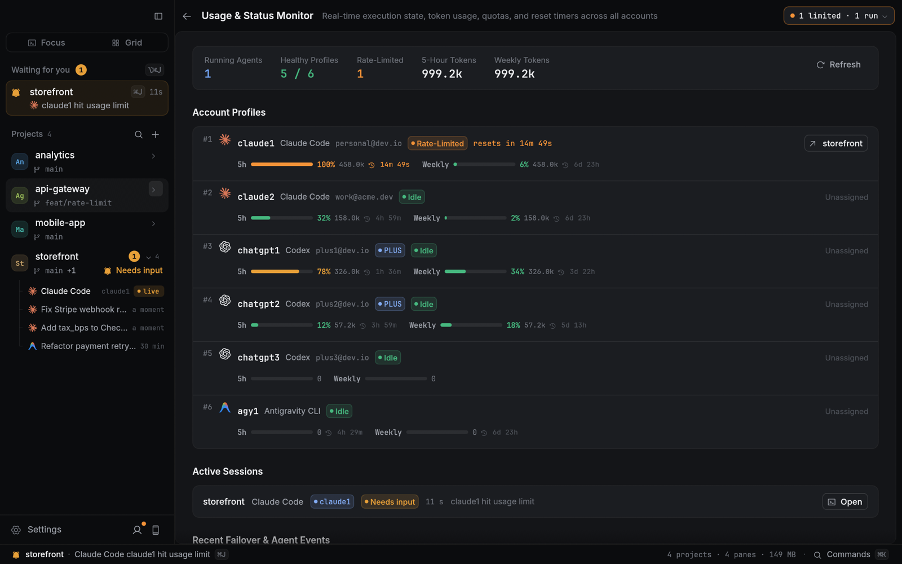
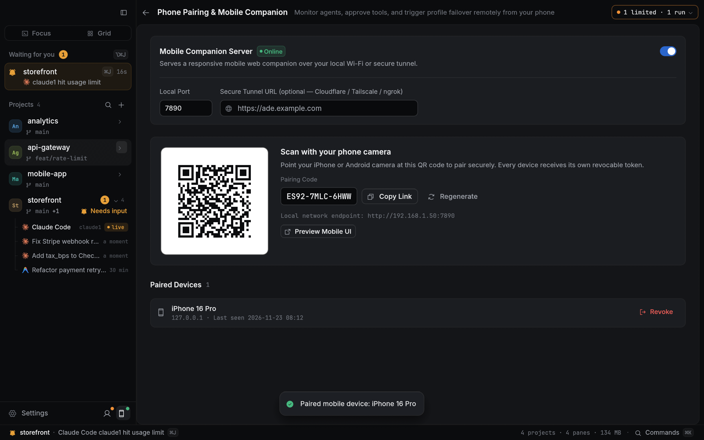
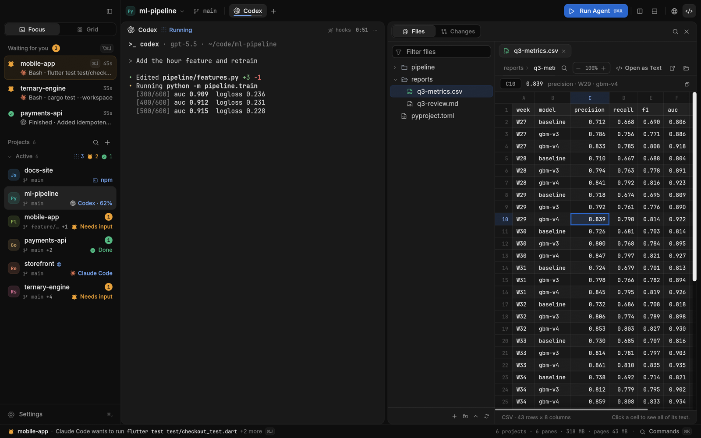

<p align="center">
  
</p>

<h1 align="center">TernaryCode</h1>

<p align="center">
  <b>Satu Agent Development Environment (ADE) native untuk semua project dan AI coding agent Anda.</b><br>
  Editor kode lebar, riwayat sesi di dalam tree project, multi-akun dengan batas 5 jam &amp; mingguan + pindah akun 1-klik, monitor pemakaian live, dan companion ponsel — ditulis dengan Rust untuk macOS, Windows, dan Linux.
</p>

<p align="center">
  <a href="https://github.com/ilhamnadhif/ternarycode/releases/latest"></a>
  <a href="https://github.com/ilhamnadhif/ternarycode/actions/workflows/ci.yml"></a>
  
  <a href="LICENSE"></a>
</p>

<p align="center">
  <a href="https://ilhamnadhif.github.io/ternarycode/"><b>Website</b></a> ·
  <a href="#instalasi">Instalasi</a> ·
  <a href="#fitur">Fitur</a> ·
  <a href="#shortcut-keyboard">Shortcut</a> ·
  <a href="#kalau-ada-masalah">Kalau ada masalah</a> ·
  <a href="#build-dari-source">Build</a> ·
  <a href="README.md">English</a>
</p>


Menjalankan **Claude Code**, **ChatGPT / Codex**, **Gemini CLI**, **Antigravity CLI**, atau **OpenCode** di banyak project biasanya berarti jendela terminal berserakan, repot logout-login ulang saat kuota akun habis, dan bingung agent mana yang sedang menunggu. TernaryCode menyatukan semua project, sesi, akun, dan editor dalam satu aplikasi native Rust yang cepat.

Tanpa Electron dan tanpa server perantara: terbuka ~0,2 detik, CPU 0% saat diam, dan seluruh kredensial tetap lokal di mesin Anda.

## Sorotan

- **Editor Kode Lebar & Panel Terminal Fleksibel**: Code Editor & Diff Viewer mengisi viewport utama (≥60% secara default), sementara Terminal, Agent Logs, dan LSP Problems berada di panel bawah/kanan yang bisa dilipat (`⇧⌘L`).
- **Riwayat Sesi di Dalam Tree Project**: klik panah `›` pada project mana pun di sidebar untuk melihat sesi aktif & riwayat **Claude Code, Codex, Gemini CLI, dan Antigravity CLI** lengkap dengan logo asli dan resume 1-klik.
- **Profil Multi-Akun & Batas 5 Jam / Mingguan**: daftarkan banyak akun sejak awal (`chatgpt1`, `chatgpt2`, `chatgpt3`, `claude1`, `claude2`, `gemini1`) dengan folder auth terisolasi. Pindah akun **1-klik tanpa logout/login ulang**, atau aktifkan failover Auto/Manual Resume saat akun kena limit.
- **Monitor Pemakaian & Status Semua Agent**: pill telemetri live di top bar, popover cepat dengan tombol Switch 1-klik, dan halaman penuh yang memantau kuota **5 jam** & **mingguan**, hitung mundur reset, sesi aktif, serta log failover.
- **Pairing Ponsel & Mobile Companion**: pindai kode QR lewat Wi-Fi lokal atau tunnel aman untuk memantau output agent secara live, menyetujui tool, mengirim prompt lanjutan, dan memindah akun dari HP.
- **Tahu Agent Mana yang Butuh Anda**: status berbasis hook (*Butuh input*, *Berjalan*, *Selesai*, *Gagal*), lompatan `⌘J`, dan **Grid** (`⌘0`) live untuk semua project.
- **Browser Agent, Review, Worktree & Dokumen**: web view bawaan yang bisa dikendalikan agent, diff berdampingan + commit/push/PR 1 tombol, git worktree terpisah, serta penampil PDF, Word, PowerPoint, Excel, CSV, dan gambar.

## Instalasi

Unduh dari [rilis terbaru](https://github.com/ilhamnadhif/ternarycode/releases/latest):

| Sistem | File |
| --- | --- |
| macOS 12+ (Apple Silicon dan Intel) | installer di bawah, atau `TernaryCode-<versi>.dmg` |
| Windows 10 (1809)+, x64 | `…-windows-x64-setup.exe`, atau `…-windows-x64.zip` portabel |
| Debian, Ubuntu, Mint | `…-linux-amd64.deb` (`-arm64.deb` di ARM) |
| Fedora, RHEL, openSUSE | `…-linux-x86_64.rpm` (`-aarch64.rpm`) |
| Linux apa pun | `…-linux-x86_64.AppImage` atau `.tar.gz` (`-aarch64` di ARM) |

**macOS**, di Terminal:

```sh
curl -fsSL https://raw.githubusercontent.com/ilhamnadhif/ternarycode/main/scripts/install.sh | bash
```

> [!IMPORTANT]
> Build belum di-notarize atau ditandatangani. Di macOS, `.dmg` dari browser diblokir: pakai installer di atas atau **System Settings → Privacy & Security → Open Anyway**. Di Windows, SmartScreen bertanya sekali: **More info → Run anyway**.

Di Linux, TernaryCode butuh OpenGL dan glibc 2.28+; panel Browser butuh WebKitGTK 4.1 (`libwebkit2gtk-4.1-0`).

## Mulai cepat

1. **Tambah project**: klik **+** di sidebar, jatuhkan folder ke jendela, atau jalankan `ternarycode .` di terminal.
2. **Daftarkan akun sejak awal** (opsional): buka **Profil** (ikon 👤 di kiri bawah), klik **+ ChatGPT / + Claude / + Gemini**, lalu klik **Auth Login** sekali per akun. Setiap akun login di folder privat `0o700` masing-masing tanpa saling menimpa.
3. **Jalankan Agent** (`⇧⌘A`): mulai Claude Code, Codex, Gemini CLI, Antigravity CLI, atau OpenCode. Buka dropdown project di sidebar kapan saja untuk melanjutkan sesi lama dengan 1 klik.
4. **Pindah akun instan**: klik tombol `⇄ <akun_berikutnya>` langsung di header pane untuk pindah akun tanpa logout, atau tekan `⌘J` untuk lompat ke agent yang menunggu.

## Fitur

### Editor Kode Lebar & Sesi Tersemat di Project

- **Workspace fokus kode**: Code Editor (`⌘E`) tampil lebar dengan split yang bisa digeser mulus, integrasi LSP (rust-analyzer, gopls, TypeScript, pyright, clangd…), serta penanda baris berubah dari git.
- **Panel Terminal yang bisa dilipat** (`⇧⌘L`): tempel Terminal, Log Agent, dan Problems di bawah atau kanan, maksimalkan saat perlu, atau sembunyikan saat membaca kode.
- **Riwayat sesi di dalam tree project**: buka project mana pun di sidebar (`›`) untuk melihat sesi aktif (`● live`) dan sesi sebelumnya dari **Claude Code**, **Codex**, **Gemini CLI**, dan **Antigravity CLI** (`agy --conversation <id>`) — sekali klik langsung fokus atau resume.

### Profil Multi-Akun, Batas 5 Jam & Mingguan, & Pindah Akun 1-Klik


- **Tanpa logout-login ulang**: daftarkan banyak akun (`chatgpt1`, `chatgpt2`, `chatgpt3`, `claude1`, `claude2`, `gemini1`) sejak awal. Setiap profil punya `CLAUDE_CONFIG_DIR`, `CODEX_HOME` berbasis file (`auth.json`), atau `GEMINI_CLI_HOME` sendiri sehingga login tidak pernah bentrok.
- **Meter Batas 5 Jam & Mingguan**: menampilkan pemakaian **jendela 5 jam** dan **mingguan (7 hari)** — membaca persentase & waktu reset langsung dari telemetri server Codex (`rate_limits.primary` / `secondary`, `plan_type`), serta jendela log 5 jam/7 hari + batas token opsional untuk Claude dan Gemini.
- **Pindah Akun Live 1-Klik & Failover**: klik tombol `⇄` di header pane agent kapan saja — atau biarkan **Auto-Resume** / **Manual Resume** mengambil alih saat kena limit. Perpindahan sesama provider otomatis menyalin file sesi dan melakukan `--resume` dengan riwayat utuh; lintas provider membuat ringkasan *handoff* dengan penyensoran secret otomatis.


### Monitor Pemakaian & Status Semua Agent



- Klik pill telemetri di top bar untuk melihat status live setiap akun (`Running`, `Idle`, `Rate-Limited`, `Cooldown`, `Error`), meter **5 jam** & **mingguan**, hitung mundur reset, dan tombol **Pindah** 1-klik tanpa meninggalkan kode.
- Buka **Tampilan Penuh** untuk ringkasan **Token 5 Jam**, **Token Mingguan**, akun sehat, tautan cepat sesi aktif, dan log failover.

### Pairing Ponsel & Mobile Companion



- Aktifkan **Server Mobile Companion** bawaan (Wi-Fi lokal atau tunnel Cloudflare / Tailscale / ngrok) lalu pindai kode QR dengan kamera HP.
- Setiap perangkat mendapat token bearer yang bisa dicabut kapan saja (lengkap dengan rate-limit brute-force dan redaksi secret). Pantau output live lewat SSE, setujui/tolak tool, kirim prompt lanjutan, dan ganti akun langsung dari ponsel.

### Review, Worktree, Grid, Browser & Dokumen


- **Review & Commit/Push/PR 1 tombol** (`⇧⌘R`, `⇧⌘C`): tinjau diff unified atau berdampingan, jalankan agent di **git worktree** terpisah, lalu commit, push, atau buka PR GitHub dalam satu langkah.
- **Grid** (`⌘0`): pantau semua project berdampingan dalam terminal sungguhan.
- **Panel Browser** (`⇧⌘B`): web view sistem (WebKit, WebView2, WebKitGTK) yang bisa dioperasikan agent sambil Anda pantau atau ambil alih kapan saja.
- **Dokumen Langsung Terbuka**: PDF, Word, PowerPoint, Excel, CSV (sebagai tabel interaktif), dan gambar langsung di samping agent.




## Shortcut keyboard

Di Windows dan Linux, `⌘` menjadi `Ctrl+Shift` (`⌥` tetap `Alt`), sehingga `Ctrl+C` tetap sampai ke terminal. Command palette (`⌘K`) menampilkan semuanya.

| macOS | Windows, Linux | |
| --- | --- | --- |
| `⌘J` · `⇧⌘J` | `Ctrl+Shift+J` · `Ctrl+Alt+J` | agent menunggu berikutnya · kembali |
| `⌘K` · `⌘P` | `Ctrl+Shift+K` · `Ctrl+Shift+P` | command palette · pindah project |
| `⇧⌘A` | `Ctrl+Shift+A` | jalankan agent |
| `⌘0` | `Ctrl+Shift+0` | Grid |
| `⌘E` · `⇧⌘L` | `Ctrl+Shift+Y` · `Ctrl+Shift+L` | Editor Kode · Panel Terminal |
| `⌘O` · `⌘S` | `Ctrl+Shift+O` · `Ctrl+Shift+S` | buka file · simpan |
| `⌘T` · `⌘W` | `Ctrl+Shift+T` · `Ctrl+Shift+W` | tab baru · tutup pane |
| `⌘D` · `⇧⌘D` | `Ctrl+Shift+D` · `Ctrl+Shift+E` | bagi ke kanan · ke bawah |
| `⇧⌘R` · `⇧⌘C` | `Ctrl+Shift+R` · `Ctrl+Shift+Alt+C` | review perubahan · commit, push & PR |
| `⇧⌘B` | `Ctrl+Shift+Alt+B` | panel Browser |
| `⌘F` · `⇧⌘F` | `Ctrl+Shift+F` · `Ctrl+Shift+G` | cari · di semua pane |
| `⌘B` · `⌥⌘B` | `Ctrl+Shift+B` · `Ctrl+Alt+B` | sidebar · sidebar sempit |
| `⌘1`–`⌘9` | `Ctrl+Shift+1`–`9` | project 1–9 |

## Kalau ada masalah

- **Agent hanya menampilkan *Active*.** Agent dijalankan manual tanpa hook: pakai **Run Agent**, atau pasang hook di **Settings → Agents**.
- **Windows: "running scripts is disabled".** Jalankan `Set-ExecutionPolicy -Scope CurrentUser RemoteSigned` sekali, atau pasang PowerShell 7 (`winget install Microsoft.PowerShell`).
- **Linux: jendela tetap kosong.** Pastikan OpenGL berjalan; `LIBGL_ALWAYS_SOFTWARE=1 ternarycode` memakai renderer software Mesa.
- Masalah lain: [buka issue](https://github.com/ilhamnadhif/ternarycode/issues).

## Privasi

Tanpa akun cloud, tanpa telemetri. TernaryCode hanya menghubungi GitHub untuk memeriksa pembaruan (opsional); Mobile Companion berjalan lokal di jaringan Anda dengan token per perangkat yang bisa dicabut dan redaksi secret otomatis. Pengaturan dan profil terisolasi disimpan di `~/Library/Application Support/ternarycode` (macOS), `%APPDATA%\ternarycode` (Windows), atau `~/.local/share/ternarycode` (Linux).

## Build dari source

```sh
cargo build --release       # ternarycode dan ternarycode-hook, berdampingan
./target/release/ternarycode
```

Sebelum pull request, jalankan `cargo clippy --locked --workspace --all-targets -- -D warnings` dan `cargo test --locked --workspace` (serta `scripts/e2e.sh` di macOS). Kode diformat manual: mohon jangan jalankan `cargo fmt` untuk seluruh file.

Dibuat dengan [egui](https://github.com/emilk/egui), [alacritty_terminal](https://github.com/alacritty/alacritty), dan [wry](https://github.com/tauri-apps/wry). Font: Inter dan JetBrains Mono (SIL OFL 1.1), ikon Phosphor (MIT).

## Lisensi

MIT.
