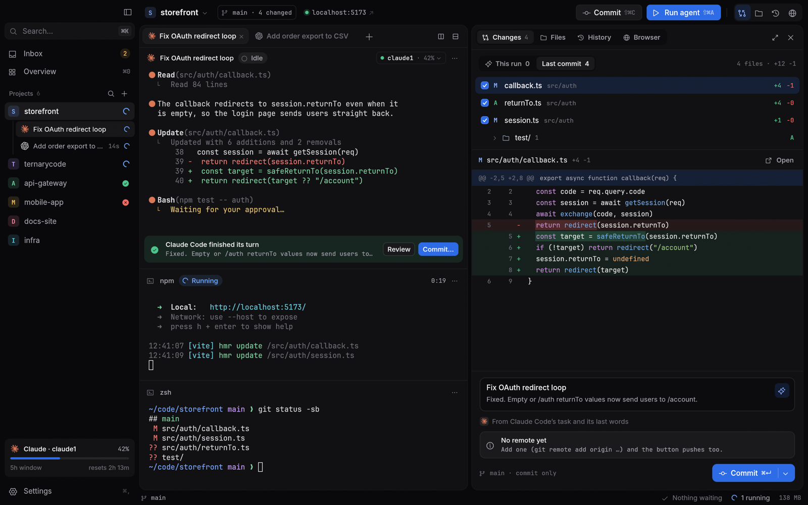
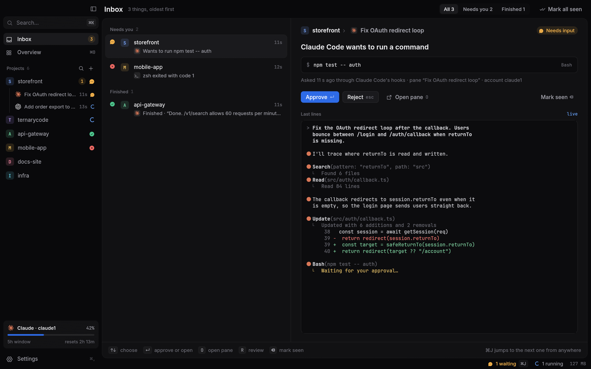
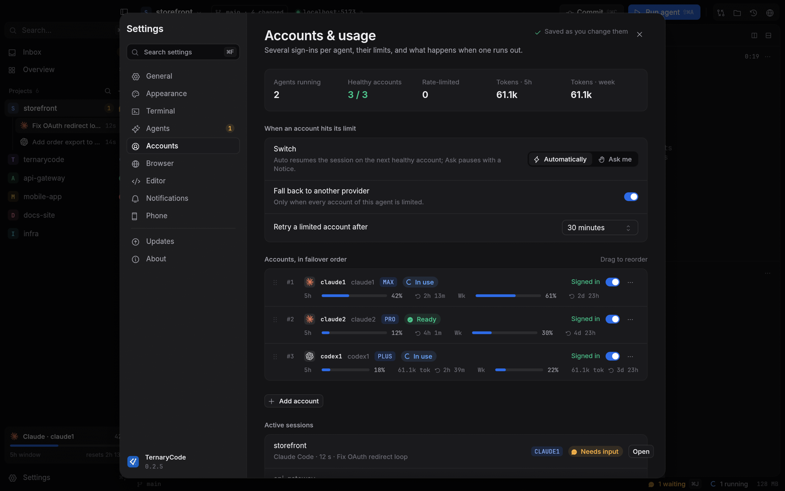
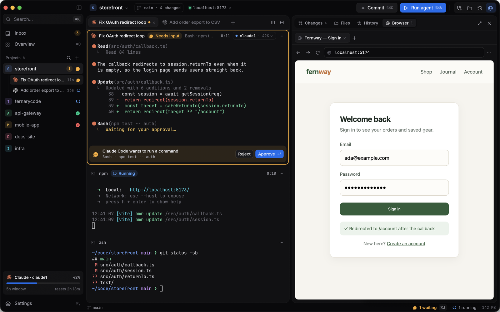

<p align="center">
  
</p>

<h1 align="center">TernaryCode</h1>

<p align="center">
  <b>Satu workspace native untuk semua project dan AI coding agent Anda.</b><br>
  Terminal di depan, status setiap agent sekilas pandang, satu Inbox untuk semua yang menunggu Anda, failover multi-akun dengan batas 5 jam &amp; mingguan yang asli, browser yang bisa dikendalikan agent, dan companion ponsel — ditulis dengan Rust untuk macOS, Windows, dan Linux.
</p>

<p align="center">
  <a href="https://github.com/ilhamnadhif/ternarycode/releases/latest"></a>
  <a href="https://github.com/ilhamnadhif/ternarycode/actions/workflows/ci.yml"></a>
  
  <a href="LICENSE"></a>
</p>

<p align="center">
  <a href="https://ilhamnadhif.github.io/ternarycode/"><b>Website</b></a> ·
  <a href="#instalasi">Instalasi</a> ·
  <a href="#fitur">Fitur</a> ·
  <a href="#shortcut-keyboard">Shortcut</a> ·
  <a href="#kalau-ada-masalah">Kalau ada masalah</a> ·
  <a href="#build-dari-source">Build</a> ·
  <a href="README.md">English</a>
</p>


Menjalankan **Claude Code**, **Codex**, **Antigravity CLI (`agy`)**, atau **OpenCode** di banyak project biasanya berarti jendela terminal berserakan, logout-login ulang saat kuota akun habis, dan menebak agent mana yang sedang menunggu. TernaryCode menyatukan semua project, sesi, akun, dan halaman web dalam satu aplikasi native yang cepat.

Tanpa Electron dan tanpa server perantara: terbuka ~0,2 detik, CPU 0% saat diam, dan semua kredensial tetap di mesin Anda.

## Sorotan

- **Terminal adalah panggung utama.** Tab dan pane terbelah per project; setiap pane menunjukkan apa yang berjalan, statusnya, berapa lama, dan akun yang dipakai. Changes, Files, History, dan Browser terbuka di satu panel di sampingnya (`⇧⌘L`, `⇧⌘E` untuk memenuhi jendela).
- **Tahu agent mana yang butuh Anda.** Status *Needs input*, *Running*, *Done*, dan *Failed* dari hook agent; pertanyaan muncul sebagai notice dengan **Approve ↵** langsung di pane. **Inbox** berisi semua yang menunggu, `⌘J` melompat ke yang berikutnya.
- **Semua project sekaligus.** **Overview** (`⌘0`) menampilkan terminal live (dan halaman web) setiap project dalam ubin; ketik langsung di ubin mana pun.
- **Akun tanpa repot logout.** Beberapa akun Claude Code dan Codex dengan login terpisah, pemakaian 5 jam dan mingguan asli dari server, dan failover 1-klik (atau otomatis) yang melanjutkan percakapan yang sama di akun berikutnya.
- **Browser yang bisa dikendalikan agent** — WebKit, WebView2, atau WebKitGTK — sementara Anda menonton, plus PDF, Word, PowerPoint, Excel, CSV, dan gambar di tempat.
- **Review lalu kirim.** Diff per run, per branch, atau per commit, pesan commit ditulis dari tugas agent, dan Commit & Push / pull request dengan satu tombol. Worktree memberi tiap agent branch sendiri.
- **Ponsel Anda** mengikuti agent lewat Wi-Fi: output live, Approve/Reject, instruksi lanjutan, dan pindah akun.

## Instalasi

Unduh dari [rilis terbaru](https://github.com/ilhamnadhif/ternarycode/releases/latest):

| Sistem | File |
| --- | --- |
| macOS 12+ (Apple Silicon dan Intel) | installer di bawah, atau `TernaryCode-<versi>.dmg` |
| Windows 10 (1809)+, x64 | `…-windows-x64-setup.exe`, atau `…-windows-x64.zip` portabel |
| Debian, Ubuntu, Mint | `…-linux-amd64.deb` (`-arm64.deb` di ARM) |
| Fedora, RHEL, openSUSE | `…-linux-x86_64.rpm` (`-aarch64.rpm`) |
| Linux apa pun | `…-linux-x86_64.AppImage` atau `.tar.gz` (`-aarch64` di ARM) |

**macOS**, di Terminal:

```sh
curl -fsSL https://raw.githubusercontent.com/ilhamnadhif/ternarycode/main/scripts/install.sh | bash
```

Installer memeriksa SHA-256 dan tanda tangan unduhan, lalu memasangnya di `/Applications`.

> [!IMPORTANT]
> Build belum di-notarize atau ditandatangani. Di macOS, `.dmg` dari browser diblokir: pakai installer di atas atau **System Settings → Privacy & Security → Open Anyway**. Di Windows, SmartScreen bertanya sekali: **More info → Run anyway**.

Di Linux, TernaryCode butuh OpenGL (renderer software juga bisa) dan glibc 2.28+; Browser butuh WebKitGTK 4.1 (`libwebkit2gtk-4.1-0`).

TernaryCode memperbarui dirinya sendiri (`.deb`, `.rpm`, dan `.zip` portabel lewat paket baru).

## Mulai cepat

1. **Tambah project**: **+** di sidebar, jatuhkan folder ke jendela, atau jalankan `ternarycode .` di terminal mana pun.
2. **Jalankan agent** (`⇧⌘A`): Claude Code, Codex, Antigravity CLI, atau OpenCode, di tab baru, tab ini, atau worktree baru — atau lanjutkan salah satu sesi sebelumnya.
3. **Jawab di tempat ia bertanya**: Approve atau Reject di pane, atau `⌘J` ke agent berikutnya yang menunggu. Semua yang menunggu ada di **Inbox**.
4. **Tambahkan akun lain** (opsional): **Settings → Accounts → Add account**, login sekali per akun, geser untuk mengatur urutan failover.

## Fitur

### Workspace



- **Sidebar**: Search (`⌘K` mencari apa saja), Inbox, Overview, lalu project Anda dengan urutan yang Anda pilih (`⌥⌘↑` / `⌥⌘↓`, `⌘1`–`⌘9`). Project terpilih menampilkan sesi dan worktree-nya; akun yang dipakai tampil di bawah sebagai satu meter.
- **Pane** dengan header yang jujur: agent, statusnya, apa yang dikerjakan atau ditanyakan, timer, dan akun (bisa diganti dari situ). Notice di dalam pane untuk pertanyaan, batas pemakaian, sesi yang bisa dilanjutkan, dan shell yang berakhir.
- **Panel kanan**: **Changes** (run ini, branch, commit terakhir), **Files** (tree dan editor dengan language server), **History** (commit, pull request, fetch), **Browser**. `⇧⌘E` memenuhi jendela; `⌥⌘Z` (Zen) hanya menampilkan terminal.
- **Command palette** (`⌘K`): project, sesi (live dan yang bisa dilanjutkan), file, output setiap pane, dan semua perintah.

### Inbox dan Overview




### Akun dan pemakaian



- Daftarkan beberapa akun **Claude Code** dan **Codex**; masing-masing punya folder login sendiri (`CLAUDE_CONFIG_DIR` / `CODEX_HOME`).
- Pemakaian asli: persentase 5 jam dan mingguan, paket, dan waktu reset, sesuai laporan agent.
- Saat sebuah akun kena batas, pane memberi tahu dan menawarkan **Resume on** akun sehat berikutnya — atau failover melakukannya untuk Anda dan melanjutkan percakapan yang sama.

### Browser dan dokumen



- Web view native yang dikendalikan agent lewat tool MCP (navigasi, klik, ketik, baca, screenshot) sementara Anda menonton; ambil alih kapan saja.
- PDF, Word, PowerPoint, Excel, CSV (sebagai tabel), dan gambar terbuka di panel Files, di samping agent yang membuatnya.

### Ponsel

Nyalakan **Settings → Phone**, pindai kode QR, dan ikuti setiap agent dari ponsel di Wi-Fi yang sama (atau tunnel Anda sendiri): output live, Approve / Reject, instruksi lanjutan, dan pindah akun. Setiap ponsel mendapat token sendiri yang bisa dicabut.

## Shortcut keyboard

Di Windows dan Linux, `⌘` adalah `Ctrl+Shift` (`⌥` tetap `Alt`), jadi `Ctrl+C` tetap sampai ke terminal. Command palette (`⌘K`) berisi semuanya.

| macOS | Windows, Linux | |
| --- | --- | --- |
| `⌘K` · `⌘P` | `Ctrl+Shift+K` · `Ctrl+Shift+P` | command palette · pindah project |
| `⌘J` · `⇧⌘J` | `Ctrl+Shift+J` · `Ctrl+Alt+J` | agent berikutnya yang menunggu · kembali |
| `⇧⌘A` | `Ctrl+Shift+A` | jalankan agent |
| `⌘0` | `Ctrl+Shift+0` | Overview |
| `⇧⌘R` · `⌘E` · `⇧⌘B` | `Ctrl+Shift+R` · `Ctrl+Shift+Y` · `Ctrl+Shift+Alt+B` | Changes · Files · Browser |
| `⇧⌘L` · `⇧⌘E` | `Ctrl+Shift+L` · `Ctrl+Alt+E` | tampilkan/sembunyikan panel · penuhi jendela |
| `⇧⌘C` | `Ctrl+Shift+Alt+C` | commit, push & pull request |
| `⌘T` · `⌘W` | `Ctrl+Shift+T` · `Ctrl+Shift+W` | tab baru · tutup pane |
| `⌘D` · `⇧⌘D` | `Ctrl+Shift+D` · `Ctrl+Shift+E` | belah kanan · bawah |
| `⌘F` · `⇧⌘F` | `Ctrl+Shift+F` · `Ctrl+Shift+G` | cari · di semua pane |
| `⌘B` · `⌥⌘B` · `⌥⌘Z` | `Ctrl+Shift+B` · `Ctrl+Alt+B` · `Ctrl+Alt+Z` | sidebar · sidebar sempit · Zen |
| `⌘1`–`⌘9` · `⌥⌘↑` `⌥⌘↓` | `Ctrl+Shift+1`–`9` · `Ctrl+Alt+↑` `↓` | project 1–9 · pindahkan project |

## Kalau ada masalah

- **Pane agent bertuliskan *Not connected*.** Agent dijalankan manual tanpa hook: klik untuk menghubungkan, pakai **Run agent**, atau pasang hook di **Settings → Agents**.
- **Windows: "running scripts is disabled".** Jalankan `Set-ExecutionPolicy -Scope CurrentUser RemoteSigned` sekali, atau pasang PowerShell 7 (`winget install Microsoft.PowerShell`).
- **Linux: jendela tetap kosong.** Periksa OpenGL; `LIBGL_ALWAYS_SOFTWARE=1 ternarycode` memakai renderer software Mesa.
- Lainnya: [buka issue](https://github.com/ilhamnadhif/ternarycode/issues) dengan versi, sistem, dan langkah-langkahnya.

## Privasi

Tanpa akun cloud, tanpa telemetri. TernaryCode hanya memeriksa GitHub untuk pembaruan aplikasi (opsional); pull request lewat `gh` / `glab` milik Anda sendiri; companion ponsel tetap di jaringan Anda (atau tunnel Anda sendiri) dengan token per perangkat yang bisa dicabut dan rahasia disensor dari yang dialirkan. Pengaturan dan folder akun ada di `~/Library/Application Support/ternarycode` (macOS), `%APPDATA%\ternarycode` (Windows), atau `~/.local/share/ternarycode` (Linux).

## Build dari source

```sh
cargo build --release       # ternarycode dan ternarycode-hook, berdampingan
./target/release/ternarycode
```

Sebelum pull request, jalankan: `cargo clippy --locked --workspace --all-targets -- -D warnings` dan `cargo test --locked --workspace` (plus `scripts/e2e.sh` di macOS). Kode diformat manual: jangan jalankan `cargo fmt` untuk seluruh file.

Dibangun dengan [egui](https://github.com/emilk/egui), [alacritty_terminal](https://github.com/alacritty/alacritty), dan [wry](https://github.com/tauri-apps/wry). Font: Inter dan JetBrains Mono (SIL OFL 1.1), ikon Phosphor (MIT).

TernaryCode adalah bagian dari keluarga Ternary bersama [TernaryGrid](https://github.com/ilhamnadhif/ternarygrid) (SQL), [TernaryWire](https://github.com/ilhamnadhif/ternarywire) (API), dan [TernaryShell](https://github.com/ilhamnadhif/ternaryshell) (SSH).

## Lisensi

MIT.
