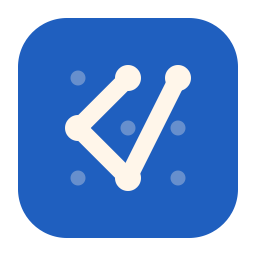
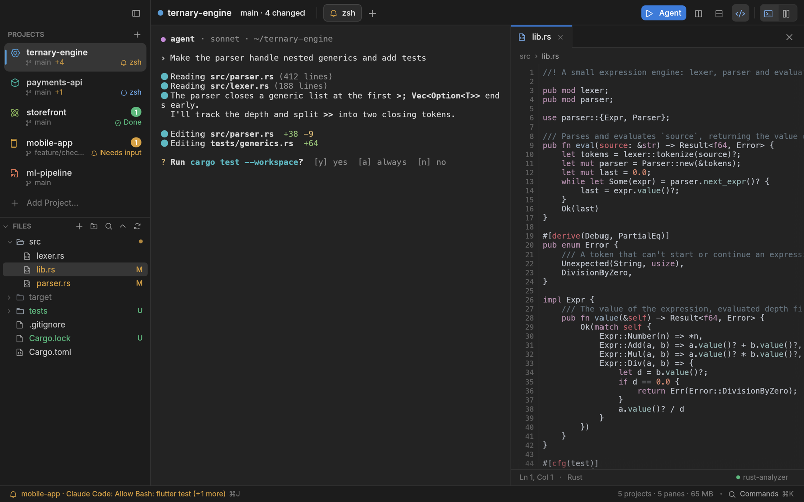
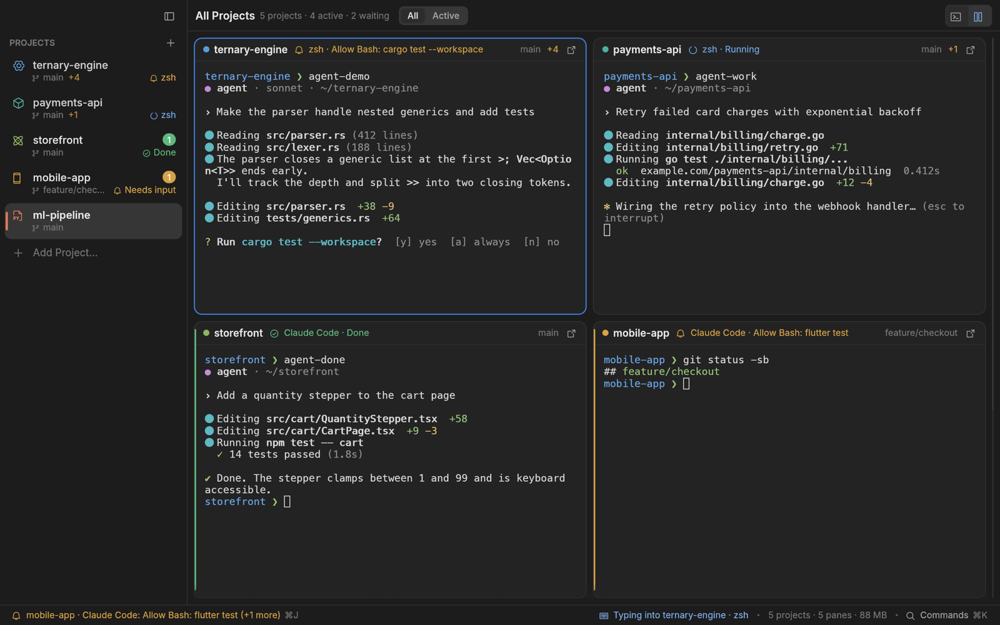
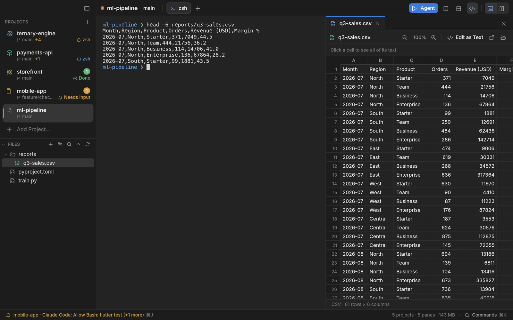

<p align="center">
  
</p>

<h1 align="center">TernaryCode</h1>

<p align="center">
  <b>Satu jendela untuk semua project Anda dan AI coding agent yang bekerja di dalamnya.</b><br>
  Workspace native berbasis terminal untuk macOS, Windows, dan Linux, seluruhnya ditulis dengan Rust.
</p>

<p align="center">
  <a href="https://github.com/ilhamnadhif/ternarycode/releases/latest"></a>
  <a href="https://github.com/ilhamnadhif/ternarycode/actions/workflows/ci.yml"></a>
  
  <a href="LICENSE"></a>
</p>

<p align="center">
  <a href="README.md">English</a> ·
  <a href="#instalasi">Instalasi</a> ·
  <a href="#fitur">Fitur</a> ·
  <a href="#shortcut-keyboard">Shortcut</a> ·
  <a href="#build-dari-source">Build</a>
</p>



Menjalankan Claude Code, Codex, Gemini CLI, atau OpenCode di lima project sekaligus biasanya
berarti lima jendela editor, masing-masing dengan agent tersembunyi di panel terminal, tanpa tahu
mana yang sedang menunggu Anda. TernaryCode menaruh semua project di **satu jendela**: masing-masing
dengan terminal, tab, dan split pane sendiri, **Grid** yang menampilkan semuanya sekaligus, dan
satu pertanyaan yang dijawab cepat dan jujur: **agent mana yang butuh saya sekarang?**

Aplikasinya satu binary native kecil (tanpa Electron, webview, atau Node.js): jendela muncul
sekitar 0,2 detik, CPU 0 % saat diam, dan sepuluh pane terbuka memakai sekitar 70 MB.

## Sorotan

- **Status agent yang bisa dipercaya.** Setiap pane tahu apakah agent-nya sedang bekerja, menunggu
  Anda, selesai, atau gagal, dari hook agent itu sendiri, notifikasi terminal, dan shell. Setiap
  status menyebut sumbernya; tanpa sinyal yang bisa dipercaya, statusnya *Tidak diketahui*, bukan
  tebakan.
- **Lompat ke yang butuh Anda.** `⌘J` membuka agent paling mendesak yang menunggu, `⇧⌘J`
  kembali. Status bar menyebut namanya, Dock menampilkan badge, dan notifikasi muncul saat jendela
  di latar belakang. Fokus keyboard tidak pernah pindah sendiri.
- **Grid** menampilkan semua project secara live, berdampingan, dengan terminal yang memenuhi
  kartunya. **Aktif** hanya menampilkan project yang sedang menjalankan sesuatu atau menunggu.
- **Editor di samping terminal**, dengan language server yang sudah Anda punya (rust-analyzer,
  gopls, typescript-language-server, Dart, pyright, clangd…): ⌘-klik ke definisi, referensi,
  rename lintas file, code action, autocomplete, hover, dan daftar problem.
- **Dokumen langsung terbuka**: PDF, Word, PowerPoint, Excel, CSV, dan gambar, hanya-baca dan cepat,
  dan bisa dicari dengan `⌘F`.
- **`ternarycode nama-project`** di terminal mana pun membuka project (atau folder) itu di jendela.
- **Review** apa yang diubah agent sejak ia mulai, atau sejak commit terakhir.
- **Memperbarui dirinya sendiri** dari rilis GitHub, cukup satu klik.

## Instalasi

Unduh dari [rilis terbaru](https://github.com/ilhamnadhif/ternarycode/releases/latest):

| Sistem | Unduhan |
| --- | --- |
| macOS 12 Monterey atau lebih baru (Apple Silicon dan Intel) | installer satu baris di bawah, atau `TernaryCode-<versi>.dmg` |
| Windows 10 (1809) atau lebih baru, x64 | `TernaryCode-<versi>-windows-x64-setup.exe`, atau `-windows-x64.zip` portabel |
| Debian, Ubuntu, Mint, Pop!_OS | `TernaryCode-<versi>-linux-amd64.deb` (`-arm64.deb` untuk ARM) |
| Fedora, RHEL, Rocky, AlmaLinux, openSUSE | `TernaryCode-<versi>-linux-x86_64.rpm` (`-aarch64.rpm`) |
| Linux lainnya (Arch, Manjaro…) | `TernaryCode-<versi>-linux-x86_64.AppImage` atau `.tar.gz` (`-aarch64` untuk ARM) |

### macOS

```sh
curl -fsSL https://raw.githubusercontent.com/ilhamnadhif/ternarycode/main/scripts/install.sh | bash
```

Skrip ini mengunduh rilis terbaru, memeriksa SHA-256 dan tanda tangan kodenya, memasang
`TernaryCode.app` ke `/Applications`, lalu membukanya. Jalankan lagi untuk memperbarui, atau beri
versi tertentu: `… | bash -s -- v0.1.0`.

Bisa juga unduh `.dmg`, buka, lalu seret **TernaryCode** ke **Applications**.

> **“TernaryCode” Not Opened / “Apple could not verify…”?** Rilis belum dinotarisasi Apple, jadi
> macOS memblokir app yang diunduh lewat browser. Pakai installer satu baris di atas (unduhan lewat
> `curl` tidak diblokir), atau klik **Done**, buka **System Settings → Privacy & Security**, lalu
> klik **Open Anyway** di samping “TernaryCode was blocked…”, atau jalankan
> `xattr -dr com.apple.quarantine /Applications/TernaryCode.app`.

### Windows

Jalankan **`TernaryCode-<versi>-windows-x64-setup.exe`**. Setup memasang untuk user Anda tanpa hak
administrator (pilih **Install for all users** di jendela pertamanya untuk memasang ke Program
Files), menambahkan TernaryCode ke Start menu, dan bisa menaruh `ternarycode` di PATH sehingga
`ternarycode .` membuka folder saat ini sebagai project (nyala secara default). Atau ekstrak **`.zip`**
portabel di mana saja.

Pane menjalankan PowerShell 7 (`pwsh`) kalau terpasang, kalau tidak Windows PowerShell, dengan
shell integration yang dimuat tanpa mengubah profil atau execution policy Anda. Agent berjalan
seperti di terminal lain (Claude Code, Codex, Gemini CLI, dan OpenCode berjalan native di Windows),
dan hook-nya sampai ke app lewat named pipe. Di Windows 10, console host bisa membuang penanda
prompt dari shell; status lalu diambil dari hook agent dan program yang sedang berjalan.

> **“Windows protected your PC”?** Build belum ditandatangani kode, jadi SmartScreen memperingatkan
> unduhan baru. Klik **More info**, lalu **Run anyway**.

### Linux

TernaryCode berjalan di X11 dan Wayland dengan OpenGL (renderer software juga bisa) dan butuh glibc
2.28 atau lebih baru (RHEL 8, Debian 10, Ubuntu 18.10, dan yang lebih baru).

```sh
sudo apt install ./TernaryCode-<versi>-linux-amd64.deb                 # Debian, Ubuntu, Mint, Pop!_OS
sudo dnf install ./TernaryCode-<versi>-linux-x86_64.rpm                # Fedora, RHEL, Rocky, AlmaLinux
chmod +x TernaryCode-<versi>-linux-x86_64.AppImage && ./TernaryCode-<versi>-linux-x86_64.AppImage
tar -xzf TernaryCode-<versi>-linux-x86_64.tar.gz -C ~/.local --strip-components=1   # lalu: ternarycode
```

### Membuka project dari terminal

```sh
ternarycode .              # folder ini, sebagai project
ternarycode ~/code/toko    # folder mana pun
ternarycode toko           # project bernama "toko" (atau folder "toko" di samping project Anda)
```

Project terbuka di jendela yang sedang berjalan (TernaryCode dijalankan kalau belum, terpisah dari
terminal, jadi menutup terminal tidak ikut menutup app). Perintah ini berfungsi di setiap pane
TernaryCode; untuk terminal lain, TernaryCode menaruhnya di `PATH` Anda saat dibuka di macOS
(`bin` Homebrew, `/usr/local/bin`, atau `~/.local/bin`, mana yang bisa Anda tulis; kalau tidak,
**Settings → General → Command line**), paket Linux memasangnya, dan setup Windows menambahkannya ke
`PATH`.

### Pembaruan

TernaryCode memeriksa rilis baru di GitHub saat dibuka dan setiap beberapa jam selama berjalan.
Kalau ada, jendela pembaruan menampilkan yang baru; **Install Update** mengunduhnya, memverifikasi
ukuran dan SHA-256 yang dipublikasikan GitHub (dan di macOS juga bundle id, versi, dan tanda
tangan kode), lalu memulai ulang ke versi baru dengan project dan tab Anda dipulihkan. Pemeriksaan
berikutnya tidak mengganggu: muncul item **Update** di status bar.

App macOS, setup Windows, AppImage, dan `.tar.gz` memperbarui dirinya sendiri; `.deb`, `.rpm`, dan
`.zip` portabel diperbarui dengan memasang paket baru. Matikan pemeriksaan otomatis di
**Settings → General**, atau pakai **Check for Updates…** kapan saja. Pemeriksaan pembaruan adalah
satu-satunya koneksi jaringan yang dibuat TernaryCode.

## Fitur

### Project, terminal, dan agent

- **Project adalah folder.** Terminalnya mulai di sana, file dan perubahan git-nya tampil di
  sampingnya, dan sidebar menunjukkan jenisnya (Rust, Go, TypeScript, React, Flutter, Python…),
  branch, jumlah perubahan, dan apa yang sedang dikerjakan agent-nya.
- **Tab dan split pane per project**, bisa diseret untuk diatur ulang, dan dipulihkan saat app
  dibuka lagi. Shell yang dipulihkan baru berjalan saat Anda melihatnya, jadi workspace berisi dua
  puluh project terbuka secepat satu project.
- **Jalankan agent** di pane baru dari preset (Claude Code, Codex, Gemini CLI, OpenCode, atau
  perintah Anda sendiri). Pane agent yang bisa melanjutkan percakapan menawarkan **Resume** setelah
  restart.
- **Terminal sungguhan**: warna 24-bit, mouse reporting, synchronized output, IME, box drawing yang
  presisi, pencarian scrollback di satu pane (`⌘F`) atau semua pane (`⇧⌘F`), dan `⌘`-klik pada
  `path:baris` untuk membukanya di editor.
- **Shell integration** (zsh, bash, fish, dan PowerShell) menandai prompt dan perintah, jadi perintah yang gagal
  atau selesai setelah lama tetap ketahuan, dan resize tidak pernah meninggalkan potongan prompt.

### Tahu agent mana yang butuh Anda



- Status tiap pane berasal dari, urut dari yang paling dipercaya: **hook** agent (dipasang per
  agent di Settings → Integrations, atau ditambahkan per peluncuran tanpa mengubah config Anda),
  notifikasi terminal (OSC 9, 99, dan 777), shell integration (OSC 133), dan proses foreground.
- **Butuh input**, **Berjalan**, **Selesai**, **Gagal**, dan **Diam** tampil di sidebar, tab, kartu
  Grid, dan status bar; daftar perhatian (`⌥⌘J`) menampilkan semua yang menunggu, yang paling lama
  lebih dulu.
- Notifikasi desktop dan badge Dock hanya muncul kalau Anda tidak sedang melihatnya.

| Agent | Per peluncuran (tanpa mengubah file) | Dipasang sekali |
| --- | --- | --- |
| Claude Code | `claude --settings "$TC_CLAUDE_SETTINGS"` menambah hook untuk sesi itu | hook di `~/.claude/settings.json` |
| Codex | `codex -c "$TC_CODEX_HOOKS" -c "$TC_CODEX_NOTIFY"` | blok terkelola di `~/.codex/config.toml` |
| Gemini CLI | — | hook di `~/.gemini/settings.json` |
| OpenCode | — | plugin `~/.config/opencode/plugins/ternarycode.js` |

Pemasangan menampilkan perubahan persisnya lebih dulu dan menyimpan backup; **Uninstall**
mengembalikan file byte demi byte kalau Anda belum mengubahnya sejak itu.

### Editor dan fitur bahasa

- Tab, nomor baris, warna sintaks, pencarian, dan penyimpanan aman: tidak pernah menimpa file yang
  diubah agent saat Anda punya perubahan yang belum disimpan (Anda yang memilih).
- Dengan language server terpasang: go to definition (`F12` atau `⌘`-klik), type definition,
  implementation, referensi (`⇧F12`), rename lintas file (`F2`, bisa di-undo sekali), code action
  dan quick fix (`⌘.`), autocomplete, hover, signature help, simbol dokumen dan workspace, problem
  (`⇧⌘M`), dan format saat menyimpan.
- Server mulai saat Anda membuka file yang dilayaninya dan berhenti sepuluh menit setelah file
  terakhir ditutup. Server yang belum terpasang disebut di status line beserta perintah
  pemasangannya.

### Dokumen



Klik file di pohon dan langsung terbuka: halaman **PDF** dirender sesuai zoom, **Word** (`.docx`)
dan **PowerPoint** (`.pptx`) sebagai teks rapi dengan heading, list, tabel, dan gambar, **Excel**
(`.xlsx`, `.xls`, `.ods`) dan **CSV** sebagai grid dengan tab sheet dan header yang tetap terlihat,
serta **gambar**. Semuanya dibaca dengan Rust murni di luar thread UI; hanya yang tampil di layar
yang disimpan di memori.

`⌘F` (`Ctrl+Shift+F`) setelah mengklik dokumen akan mencarinya: kata di halaman PDF disorot tepat di
tempatnya, teks Word dan PowerPoint disorot di tempat, dan di spreadsheet pilihan sel berpindah ke
sel yang cocok, lintas sheet. `Enter` dan `⇧Enter` pindah ke hasil berikutnya dan sebelumnya.

### Review

`⇧⌘R` menampilkan apa yang berubah: sejak agent di pane ini mulai (snapshot diambil di luar index
git, jadi staging area Anda tidak tersentuh), atau sejak commit terakhir. Buka file mana pun dari
diff di editor.

## Shortcut keyboard

Di Windows dan Linux, shortcut `⌘` menjadi `Ctrl+Shift+…`, jadi `Ctrl+C`, `Ctrl+D`, dan
sejenisnya tetap sampai ke terminal. Command palette (`⌘K` / `Ctrl+Shift+K`) memuat semua sisanya.

| macOS | Windows, Linux | |
| --- | --- | --- |
| `⌘J` · `⇧⌘J` | `Ctrl+Shift+J` | agent berikutnya yang menunggu · kembali |
| `⌘K` | `Ctrl+Shift+K` | command palette |
| `⌘P` | `Ctrl+Shift+P` | pindah project |
| `⇧⌘A` | `Ctrl+Shift+A` | jalankan agent |
| `⌘0` | `Ctrl+Shift+0` | Grid semua project |
| `⌘T` · `⌘W` | `Ctrl+Shift+T` · `Ctrl+Shift+W` | tab baru · tutup pane |
| `⌘D` · `⇧⌘D` | `Ctrl+Shift+D` · `Ctrl+Shift+E` | split kanan · split bawah |
| `⌘O` · `⌘E` · `⌘S` | `Ctrl+Shift+O` · `Ctrl+Shift+Y` · `Ctrl+Shift+S` | buka file · tampilkan editor · simpan |
| `⇧⌘R` | `Ctrl+Shift+R` | review perubahan |
| `⌘F` · `⇧⌘F` | `Ctrl+Shift+F` · `Ctrl+Shift+G` | cari di pane, file, atau dokumen · di semua pane |
| `⌘B` · `⌘1`–`⌘9` | `Ctrl+Shift+B` | sidebar · project 1–9 |
| `F12` · `⇧F12` · `F2` · `⌘.` | sama | definisi · referensi · rename · code action |

## Privasi

Tanpa akun, tanpa telemetri. Satu-satunya koneksi yang dibuat TernaryCode adalah pemeriksaan
pembaruan ke GitHub, dan itu bisa dimatikan. Hook berbicara dengan app lewat socket lokal privat
(named pipe di Windows), dan setiap pane punya token rahasianya sendiri.

Pengaturan dan workspace disimpan di `~/Library/Application Support/ternarycode` (macOS),
`%APPDATA%\ternarycode` (Windows), atau `~/.local/share/ternarycode` (Linux).

## Build dari source

Butuh toolchain Rust stable yang baru (dibangun dengan 1.99).

```sh
cargo build --release      # ternarycode dan ternarycode-hook, berdampingan di target/release
./target/release/ternarycode
```

`ternarycode-hook` harus tetap berada di samping binary app: hook agent menjalankannya, dan ia tidak
melakukan apa-apa di luar pane TernaryCode.

| | |
| --- | --- |
| `scripts/package.sh` | macOS: `TernaryCode.app`, `.dmg`, dan `.zip` (ad-hoc signed kecuali identitas diset) |
| `scripts/package-linux.sh` | Linux: `.tar.gz`, `.deb`, `.rpm`, `.AppImage` |
| `scripts/package-windows.ps1` | Windows: installer Inno Setup dan `.zip` portabel |
| `scripts/e2e.sh` | pengujian end-to-end app sungguhan di macOS (event keyboard dan mouse disuntikkan) |
| `scripts/release.sh <x.y.z>` | tes, build macOS, tag, lalu CI membangun Windows dan Linux dan mempublikasikan |

## Keluarga Ternary

TernaryCode adalah satu dari empat app Rust native kecil yang berbagi tampilan dan ikon kisi 3 × 3:
[TernaryGrid](https://github.com/ilhamnadhif/ternarygrid) (klien SQL),
[TernaryWire](https://github.com/ilhamnadhif/ternarywire) (klien API),
[TernaryShell](https://github.com/ilhamnadhif/ternaryshell) (klien SSH dan SFTP), dan TernaryCode.

## Lisensi

MIT. Font: Inter (SIL OFL 1.1) dan ikon Phosphor (MIT).
