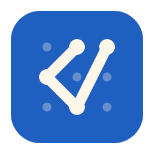
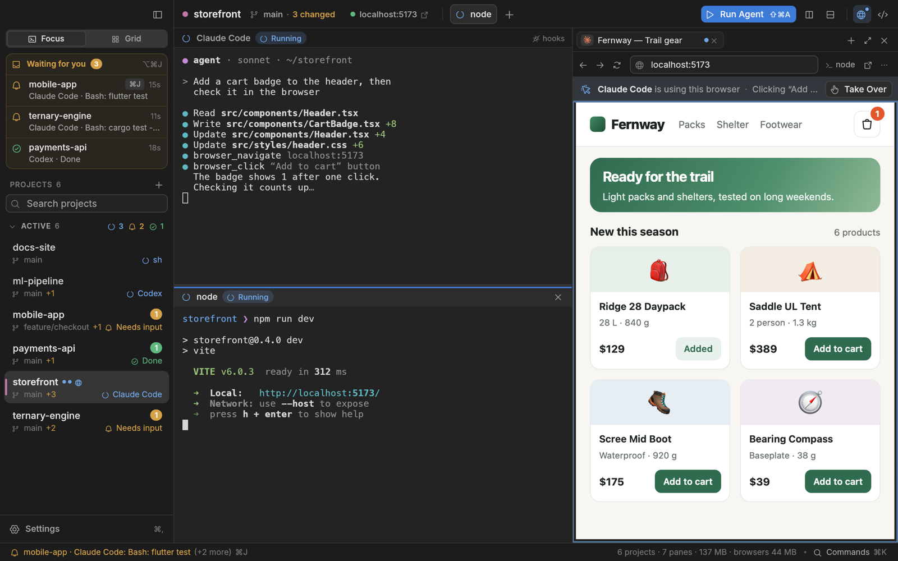
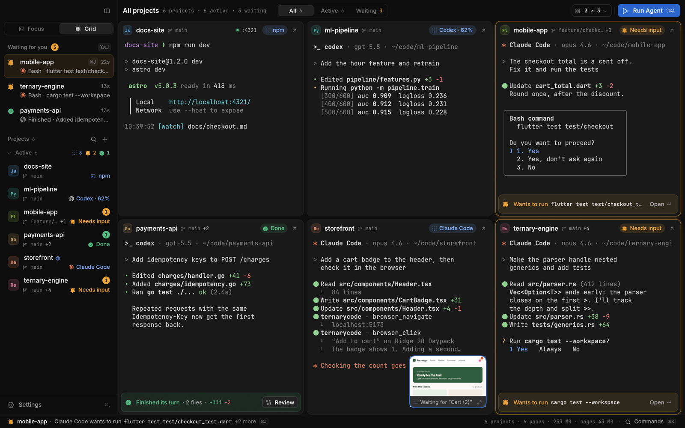
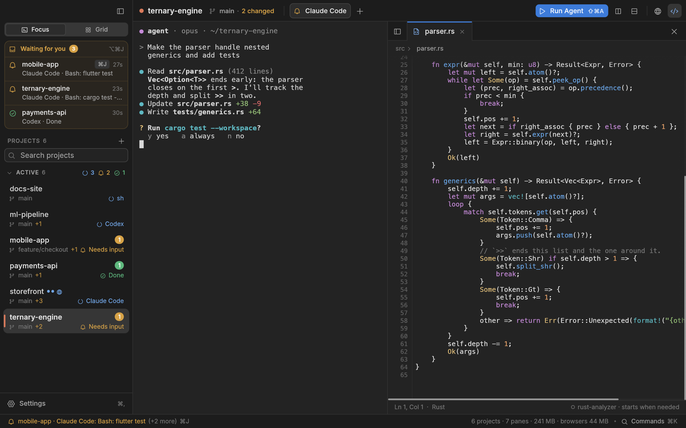

<p align="center">
  
</p>

<h1 align="center">TernaryCode</h1>

<p align="center">
  <b>Satu jendela untuk semua project Anda dan AI coding agent yang bekerja di dalamnya.</b><br>
  Workspace native berbasis terminal untuk macOS, Windows, dan Linux, ditulis dengan Rust.
</p>

<p align="center">
  <a href="https://github.com/ilhamnadhif/ternarycode/releases/latest"></a>
  <a href="https://github.com/ilhamnadhif/ternarycode/actions/workflows/ci.yml"></a>
  
  <a href="LICENSE"></a>
</p>

<p align="center">
  <a href="https://ilhamnadhif.github.io/ternarycode/"><b>Website</b></a> ·
  <a href="#instalasi">Instalasi</a> ·
  <a href="#fitur">Fitur</a> ·
  <a href="#shortcut-keyboard">Shortcut</a> ·
  <a href="#kalau-ada-masalah">Kalau ada masalah</a> ·
  <a href="#build-dari-source">Build</a> ·
  <a href="README.md">English</a>
</p>



Menjalankan Claude Code, Codex, Antigravity CLI, atau OpenCode di beberapa project sekaligus
biasanya berarti banyak jendela tanpa tahu agent mana yang sedang menunggu Anda. TernaryCode menaruh
semua project di satu jendela, masing-masing dengan terminal, tab, dan split sendiri, dan menjawab
satu pertanyaan sekilas pandang: **agent mana yang butuh saya sekarang?**

Aplikasinya native dan kecil (tanpa Electron): terbuka sekitar 0,2 detik, CPU 0 % saat diam, dan
sepuluh pane memakai sekitar 70 MB.

## Sorotan

- **Tahu agent mana yang butuh Anda.** *Butuh input*, *Berjalan*, *Selesai*, dan *Gagal* datang dari
  hook agent itu sendiri, bukan tebakan. `⌘J` membuka yang paling mendesak.
- **Semua project di satu jendela**, dan **Grid** yang menampilkan semuanya secara live.
- **Browser yang bisa dipakai agent.** Agent membuka dev server Anda di samping terminalnya,
  mengklik halamannya, dan membaca console-nya; Anda melihatnya dan bisa mengambil alih kapan saja.
- **Kode di samping agent**: file yang diubahnya, baris yang disentuhnya, language server Anda.
- **Review** apa yang diubah agent, dan beri setiap agent **git worktree** sendiri.
- **Dokumen langsung terbuka**: PDF, Word, PowerPoint, Excel, CSV, dan gambar.

## Instalasi

Unduh dari [rilis terbaru](https://github.com/ilhamnadhif/ternarycode/releases/latest):

| Sistem | File |
| --- | --- |
| macOS 12+ (Apple Silicon dan Intel) | installer di bawah, atau `TernaryCode-<versi>.dmg` |
| Windows 10 (1809)+, x64 | `…-windows-x64-setup.exe`, atau `…-windows-x64.zip` portabel |
| Debian, Ubuntu, Mint | `…-linux-amd64.deb` (`-arm64.deb` di ARM) |
| Fedora, RHEL, openSUSE | `…-linux-x86_64.rpm` (`-aarch64.rpm`) |
| Linux apa pun | `…-linux-x86_64.AppImage` atau `.tar.gz` (`-aarch64` di ARM) |

**macOS**, di Terminal:

```sh
curl -fsSL https://raw.githubusercontent.com/ilhamnadhif/ternarycode/main/scripts/install.sh | bash
```

Skrip ini memeriksa SHA-256 dan tanda tangan unduhan, lalu memasangnya ke `/Applications`.

> [!IMPORTANT]
> Build-nya belum di-notarize atau ditandatangani. Di macOS, `.dmg` yang diunduh lewat browser
> diblokir: pakai installer di atas, atau **System Settings → Privacy & Security → Open Anyway**. Di
> Windows, SmartScreen bertanya sekali: **More info → Run anyway**.

Di Linux, TernaryCode butuh OpenGL (renderer software pun cukup) dan glibc 2.28+; panel Browser butuh
WebKitGTK 4.1 (`libwebkit2gtk-4.1-0`).

TernaryCode memperbarui dirinya sendiri (`.deb`, `.rpm`, dan `.zip` portabel lewat paket baru).

## Mulai cepat

1. **Tambah project**: klik **+** di sidebar, jatuhkan folder ke jendela, atau jalankan
   `ternarycode .` di terminal mana pun. Saat pertama dibuka, TernaryCode menawarkan repositori git
   yang ditemukannya di folder yang biasa Anda pakai.
2. **Run Agent** (`⇧⌘A`): pilih Claude Code, Codex, Antigravity CLI, atau OpenCode. Agent dimulai di
   terminal tempat Anda berada dan melaporkan statusnya untuk jalan itu.
3. Kerjakan hal lain. Saat agent menunggu, project-nya menampilkan **Butuh input** dan status bar
   menyebutnya: `⌘J` membawa Anda ke sana, `⇧⌘J` kembali.

Agent dipasang terpisah (`claude`, `codex`, `agy`, `opencode`); bila belum ada, Run Agent
menunjukkan cara memasangnya.

## Fitur

### Project, terminal, dan agent

- **Project adalah folder**: terminal, file, dan perubahan git-nya. Sidebar menampilkan jenis,
  branch, perubahan, dan apa yang dikerjakan agent-nya; `⌥⌘B` menyempitkannya menjadi kolom tile
  project.
- **Tab dan split per project**, dipulihkan saat aplikasi dibuka lagi. Shell yang dipulihkan baru
  dimulai saat Anda melihatnya, jadi dua puluh project terbuka secepat satu.
- **Run Agent** menjalankan preset (atau perintah Anda sendiri) di terminal tempat Anda berada, tab
  baru, atau split, bisa juga di **git worktree baru**, sehingga agent tidak saling menimpa file.
  Agent yang bisa melanjutkan percakapan menawarkan **Resume** setelah restart.
- **Terminal sungguhan**: warna 24-bit, mouse, IME, link (`⌘`-klik), pencarian (`⌘F`, `⇧⌘F` di semua
  pane), shell integration untuk zsh, bash, fish, dan PowerShell. Server lokal yang dijalankan pane
  muncul sebagai chip; sekali klik membukanya di panel Browser.

### Tahu agent mana yang butuh Anda



- Status datang dari **hook** agent, lalu notifikasi terminal, shell integration, dan program yang
  berjalan. Tanpa sinyal yang bisa dipercaya, statusnya *Active*, bukan tebakan.
- **Waiting for you** di atas sidebar menampilkan agent yang menunggu, gagal, atau selesai, sesuai
  urutan yang dikunjungi `⌘J`. Notifikasi dan badge Dock muncul hanya saat Anda sedang tidak melihat.
- **Grid** (`⌘0`) menampilkan semua project secara live; tile agent yang selesai menyebut berapa file
  yang diubahnya, lengkap dengan tombol **Review**.

Hook ditambahkan **per jalan** untuk Claude Code dan Codex (tanpa mengubah konfigurasi Anda), atau
**dipasang sekali** (Settings → Agents) agar agent yang Anda jalankan sendiri juga melapor. Saat
memasang, perubahannya ditunjukkan persis dan cadangannya disimpan; **Uninstall** mengembalikan file
byte demi byte. Antigravity CLI belum punya hook: statusnya *Active*.

### Browser untuk Anda dan agent Anda

Setiap project punya **panel Browser** di samping terminalnya (`⇧⌘B`), memakai web view sistem
(WebKit, WebView2, WebKitGTK).

- **Agent memeriksa pekerjaannya sendiri**: membuka halaman, mengklik, mengetik, menggulir, membaca
  halaman dan console, menjawab dialog, mengunggah file. Klik dan ketikannya adalah event sungguhan.
  Anda melihat apa yang dilakukan agent; klik atau ketik di halaman untuk **Take Over**, **Hand Back**
  untuk membiarkannya lanjut.
- **Bekerja seperti browser**: pop-up login, unduhan, cari di halaman, zoom, web inspector, satu
  profil login untuk semua project.
- Setiap agent mendapat halamannya sendiri; halaman yang sibuk tidak pernah tidur; agent tidak pernah
  mengetik password Anda.

### Kode, Review, dan dokumen



- **Laci Code** (`⌘E`) terbuka di samping terminal: file yang diubah agent ditandai logonya, dan baris
  yang ditambah, diubah, atau dihapus sejak agent mulai ditandai di samping nomor baris. Dengan
  language server Anda (rust-analyzer, gopls, TypeScript, pyright, clangd…): definisi, referensi,
  rename, code action, completion, hover, dan problems. Server hanya dimulai saat dibutuhkan.
- **Review** (`⇧⌘R`) menampilkan apa yang berubah sejak agent mulai atau sejak commit terakhir,
  dengan kata yang berubah disorot, unified atau berdampingan. Review worktree menampilkan
  commit-nya, diakhiri **Merge** dan **Remove**.
- **Dokumen** langsung terbuka: PDF, Word, PowerPoint, Excel, dan CSV (sebagai tabel), serta gambar,
  dibaca dengan Rust di luar thread UI.


### Platform

macOS, Windows, dan Linux mendapat aplikasi yang sama. Di Windows, TernaryCode menggambar title bar
sendiri dengan menu, pane memakai PowerShell 7 (atau Windows PowerShell), dan hook memakai named pipe.
Di Linux, panel Browser butuh WebKitGTK; tanpanya, halaman terbuka di browser default Anda. Tes
end-to-end aplikasi sungguhan berjalan di macOS.

## Shortcut keyboard

Di Windows dan Linux, `⌘` menjadi `Ctrl+Shift` (`⌥` tetap `Alt`), sehingga `Ctrl+C` tetap sampai ke
terminal. Command palette (`⌘K`) menampilkan semuanya.

| macOS | Windows, Linux | |
| --- | --- | --- |
| `⌘J` · `⇧⌘J` | `Ctrl+Shift+J` · `Ctrl+Alt+J` | agent menunggu berikutnya · kembali |
| `⌘K` · `⌘P` | `Ctrl+Shift+K` · `Ctrl+Shift+P` | command palette · pindah project |
| `⇧⌘A` | `Ctrl+Shift+A` | jalankan agent |
| `⌘0` | `Ctrl+Shift+0` | Grid |
| `⌘T` · `⌘W` | `Ctrl+Shift+T` · `Ctrl+Shift+W` | tab baru · tutup pane |
| `⌘D` · `⇧⌘D` | `Ctrl+Shift+D` · `Ctrl+Shift+E` | bagi ke kanan · ke bawah |
| `⌘E` · `⌘O` · `⌘S` | `Ctrl+Shift+Y` · `Ctrl+Shift+O` · `Ctrl+Shift+S` | laci Code · buka file · simpan |
| `⇧⌘R` | `Ctrl+Shift+R` | review perubahan |
| `⇧⌘B` | `Ctrl+Shift+Alt+B` | panel Browser |
| `⌘F` · `⇧⌘F` | `Ctrl+Shift+F` · `Ctrl+Shift+G` | cari · di semua pane |
| `⌘B` · `⌥⌘B` | `Ctrl+Shift+B` · `Ctrl+Alt+B` | sidebar · sidebar sempit |
| `⌘1`–`⌘9` | `Ctrl+Shift+1`–`9` | project 1–9 |

## Kalau ada masalah

- **Agent hanya menampilkan *Active*.** Agent dijalankan manual tanpa hook: pakai **Run Agent**, atau
  pasang hook di **Settings → Agents**.
- **Windows: "running scripts is disabled".** Jalankan `Set-ExecutionPolicy -Scope CurrentUser RemoteSigned`
  sekali, atau pasang PowerShell 7 (`winget install Microsoft.PowerShell`).
- **Linux: jendela tetap kosong.** Pastikan OpenGL berjalan; `LIBGL_ALWAYS_SOFTWARE=1 ternarycode`
  memakai renderer software Mesa.
- Masalah lain: [buka issue](https://github.com/ilhamnadhif/ternarycode/issues) dengan versi, sistem,
  dan langkah-langkahnya.

## Privasi

Tanpa akun, tanpa telemetri. TernaryCode hanya terhubung ke GitHub untuk memeriksa update (bisa
dimatikan). Hook dan tool browser berbicara dengan aplikasi lewat socket lokal dengan token per pane.
Pengaturan disimpan di `~/Library/Application Support/ternarycode` (macOS), `%APPDATA%\ternarycode`
(Windows), atau `~/.local/share/ternarycode` (Linux).

## Build dari source

```sh
cargo build --release       # ternarycode dan ternarycode-hook, berdampingan
./target/release/ternarycode
```

Sebelum pull request, jalankan yang dijalankan CI: `cargo clippy --workspace --all-targets -- -D warnings`
dan `cargo test --workspace` (dan `scripts/e2e.sh` di macOS, yang menjalankan aplikasi sungguhan). Kode
diformat manual: mohon jangan jalankan `cargo fmt` untuk seluruh file.

Dibuat dengan [egui](https://github.com/emilk/egui), [alacritty_terminal](https://github.com/alacritty/alacritty),
dan [wry](https://github.com/tauri-apps/wry). Font: Inter dan JetBrains Mono (SIL OFL 1.1), ikon
Phosphor (MIT).

TernaryCode adalah salah satu aplikasi Ternary, bersama [TernaryGrid](https://github.com/ilhamnadhif/ternarygrid)
(SQL), [TernaryWire](https://github.com/ilhamnadhif/ternarywire) (API), dan
[TernaryShell](https://github.com/ilhamnadhif/ternaryshell) (SSH).

## Lisensi

MIT.
