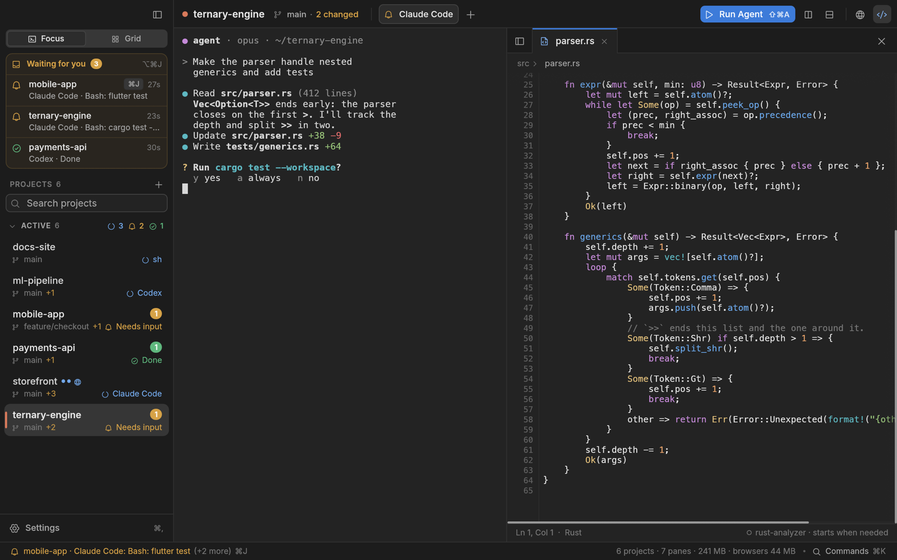

<p align="center">
  
</p>

<h1 align="center">TernaryCode</h1>

<p align="center">
  <b>One window for all your projects and the AI coding agents working in them.</b><br>
  A native, terminal-first workspace for macOS, Windows and Linux, written entirely in Rust.
</p>

<p align="center">
  <a href="https://github.com/ilhamnadhif/ternarycode/releases/latest"></a>
  <a href="https://github.com/ilhamnadhif/ternarycode/actions/workflows/ci.yml"></a>
  
  <a href="LICENSE"></a>
</p>

<p align="center">
  <a href="#quick-start">Quick start</a> ·
  <a href="#install">Install</a> ·
  <a href="#features">Features</a> ·
  <a href="#keyboard-shortcuts">Shortcuts</a> ·
  <a href="#troubleshooting">Troubleshooting</a> ·
  <a href="#build-from-source">Build</a> ·
  <a href="README.id.md">Bahasa Indonesia</a>
</p>


Running Claude Code, Codex, Gemini CLI or OpenCode in five projects at once usually means five
editor windows, each with an agent hidden in a terminal panel, and no idea which one is waiting
for you. TernaryCode puts every project in **one window**: each with its own terminals, tabs and
split panes, a **Grid** that shows them all at once, and one question answered quickly and
honestly: **which agent needs me now?**

It is one small native binary (no Electron, no Node.js; its browser uses the WebKit that comes
with macOS): the window is up in about 0.2 s, it idles at 0 % CPU, and ten open panes take around
70 MB.

> [!NOTE]
> **TernaryCode is young (0.x) and moves fast.** macOS is the most tested platform: it runs the
> end-to-end tests, and the browser panel is macOS-only for now. The Windows and Linux builds are
> newer. Bug reports and ideas are welcome in
> [Issues](https://github.com/ilhamnadhif/ternarycode/issues).

## Highlights

- **See which agent needs you.** Every pane shows *Needs input*, *Running*, *Done* or *Failed*,
  from the agent's own hooks, never a guess. `⌘J` jumps to the most urgent one.
- **All your projects in one window**, each with its own terminals, tabs and splits. The **Grid**
  shows them all live, side by side.
- **A browser your agents can use** (macOS). An agent opens your dev server beside its terminal,
  clicks through it and reads the console. You watch every step and can take over at any time.
- **An editor with your language servers**, a click away when you want to read the code.
- **Documents open in place**: PDF, Word, PowerPoint, Excel, CSV and images.
- **Review what an agent changed**, and give each agent **a git worktree of its own** when several
  work in one repository.
- **Works with** Claude Code, Codex, Gemini CLI and OpenCode, or any command you run in a terminal.

## Quick start

1. [Install TernaryCode](#install) and open it.
2. **Add a project**: click **+** next to *Projects*, drop a folder on the sidebar, or run
   `ternarycode .` in a terminal.
3. Click **Run Agent** (`⇧⌘A`) and pick Claude Code, Codex, Gemini CLI or OpenCode. It starts in
   the terminal you are in (or in a new tab when that one is busy) and reports its status to
   TernaryCode for that run.
4. Go on with other work. When an agent waits for you, its project shows **Needs input** and the
   status bar names it: `⌘J` takes you there, `⇧⌘J` back.
5. Optional: **Settings → Integrations** installs the hooks once, so agents you start by hand
   report their status too.

The agent must be installed on its own (`claude`, `codex`, `gemini` or `opencode`); TernaryCode
runs it, it does not bundle it. When one isn't installed, Run Agent says so and shows its install
command, with **Install in Terminal**.

## Install

Download from the [latest release](https://github.com/ilhamnadhif/ternarycode/releases/latest):

| System | Download |
| --- | --- |
| macOS 12 Monterey or later (Apple Silicon and Intel) | the one-line installer below, or `TernaryCode-<version>.dmg` |
| Windows 10 (1809) or later, x64 | `TernaryCode-<version>-windows-x64-setup.exe`, or the portable `-windows-x64.zip` |
| Debian, Ubuntu, Mint, Pop!_OS | `TernaryCode-<version>-linux-amd64.deb` (`-arm64.deb` on ARM) |
| Fedora, RHEL, Rocky, AlmaLinux, openSUSE | `TernaryCode-<version>-linux-x86_64.rpm` (`-aarch64.rpm`) |
| Any Linux (Arch, Manjaro…) | `TernaryCode-<version>-linux-x86_64.AppImage` or `.tar.gz` (`-aarch64` on ARM) |

### macOS

```sh
curl -fsSL https://raw.githubusercontent.com/ilhamnadhif/ternarycode/main/scripts/install.sh | bash
```

The script downloads the latest release, checks its SHA-256 and code signature, installs
`TernaryCode.app` into `/Applications` and opens it. Run it again to update, or pass a version:
`… | bash -s -- v0.1.0`.

Or download the `.dmg`, open it and drag **TernaryCode** onto **Applications**.

> [!IMPORTANT]
> **“TernaryCode” Not Opened / “Apple could not verify…”?** Releases are not notarized by Apple
> yet, so macOS blocks an app downloaded with a browser. Use the one-line installer above (nothing
> downloaded with `curl` is blocked), or click **Done**, open **System Settings → Privacy &
> Security** and click **Open Anyway** next to “TernaryCode was blocked…”, or run
> `xattr -dr com.apple.quarantine /Applications/TernaryCode.app`.

### Windows

Run **`TernaryCode-<version>-windows-x64-setup.exe`**. It installs for your user without
administrator rights (choose **Install for all users** in its first window to use Program Files),
adds TernaryCode to the Start menu, and can put `ternarycode` on the PATH so `ternarycode .` opens
the current folder as a project (on by default). Or unpack the portable **`.zip`** anywhere.

Panes run PowerShell 7 (`pwsh`) when it is installed, otherwise Windows PowerShell, with shell
integration loaded without touching your profile or execution policy. Agents run as they do in any
terminal (Claude Code, Codex, Gemini CLI and OpenCode all work natively on Windows), and their
hooks reach the app over a named pipe.

The window has TernaryCode's own title bar, as Windows apps do: the app's name and its menus
(File, Edit, View, Agent, Window, Help, the ones the Mac menu bar has, with their shortcuts) at
the left, minimise, maximise and close at the right. Drag it to move the window (and snap it to a
side), double-click it to maximise, right-click it for the window menu. Every new pane reads the
`PATH` Windows has now, so a program installed while TernaryCode runs is found without restarting
it, as in Windows Terminal. The terminal font is Cascadia Mono when it is installed (Windows 11),
else Consolas.

> [!IMPORTANT]
> **“Windows protected your PC”?** The builds are not code-signed yet, so SmartScreen warns about
> a new download. Click **More info**, then **Run anyway**.

### Linux

TernaryCode runs on X11 and Wayland with OpenGL (a software renderer is fine) and needs glibc 2.28
or later (RHEL 8, Debian 10, Ubuntu 18.10 and newer).

```sh
sudo apt install ./TernaryCode-<version>-linux-amd64.deb               # Debian, Ubuntu, Mint, Pop!_OS
sudo dnf install ./TernaryCode-<version>-linux-x86_64.rpm              # Fedora, RHEL, Rocky, AlmaLinux
chmod +x TernaryCode-<version>-linux-x86_64.AppImage && ./TernaryCode-<version>-linux-x86_64.AppImage
tar -xzf TernaryCode-<version>-linux-x86_64.tar.gz -C ~/.local --strip-components=1   # then: ternarycode
```

### Open projects from a terminal

```sh
ternarycode .              # this folder, as a project
ternarycode ~/code/shop    # any folder
ternarycode shop           # the project named "shop" (or the folder "shop" beside your projects)
```

The project opens in the running window (TernaryCode starts if it isn't running, apart from the
terminal, so closing the terminal doesn't close it). The command works in every TernaryCode pane;
for other terminals, TernaryCode puts it on your `PATH` at launch on macOS (Homebrew's `bin`,
`/usr/local/bin` or `~/.local/bin`, whichever you can write; otherwise **Settings → General →
Command line**), the Linux packages install it, and the Windows setup adds it to `PATH`.

### Updates

TernaryCode checks GitHub for a new release when it starts and every few hours while it runs.
When one is out, the update window shows what's new; **Install Update** downloads it, verifies its
size and the SHA-256 GitHub publishes (and on macOS the bundle id, version and code signature),
then restarts into the new version with your projects and tabs restored (on macOS and with the
Linux `.tar.gz`, the programs in your panes, agents included, keep running through it). Later checks don't interrupt you: an **Update** item appears in the status
bar instead.

The `.dmg`/installer copy on macOS, the Windows setup, the AppImage and the `.tar.gz` update
themselves; the `.deb`, `.rpm` and the portable `.zip` are updated by installing the new package.
Turn automatic checks off in **Settings → General**, or use **Check for Updates…** any time.

### Uninstall

1. If you installed agent hooks, remove them first in **Settings → Integrations** (each agent's
   **Uninstall** restores its config file). On macOS, **Settings → Browser → Logins & cookies →
   Clear…** forgets the browser's logins.
2. Remove the app:
   - **macOS**: move `/Applications/TernaryCode.app` to the Trash, and delete the `ternarycode`
     link it made at launch (in Homebrew's `bin`, `/usr/local/bin`, `~/.local/bin` or `~/bin`).
   - **Windows**: **Settings → Apps → Installed apps → TernaryCode → Uninstall** (or delete the
     portable folder).
   - **Linux**: `sudo apt remove ternarycode` or `sudo dnf remove ternarycode`; for the
     `.tar.gz`, delete `~/.local/bin/ternarycode`, `~/.local/bin/ternarycode-hook` and
     `~/.local/share/applications/ternarycode.desktop`; for the AppImage, delete it and the
     `~/.local/bin/ternarycode` link.
3. Delete the settings and workspace, if you don't want them back:
   `~/Library/Application Support/ternarycode` (macOS), `%APPDATA%\ternarycode` (Windows) or
   `~/.local/share/ternarycode` (Linux).

## Features

### Projects, terminals and agents

- **A project is a folder.** Its terminals start there, its files and git changes show beside
  them, and the sidebar shows its kind (Rust, Go, TypeScript, React, Flutter, Python…), branch,
  number of changes and what its agent is doing. Projects where something runs or waits are
  grouped under **Active** at the top of the sidebar (Settings → General turns this off); the rest
  are listed by name.
- **Tabs and split panes per project**, drag to rearrange, and restored when you open the app
  again. Restored shells start only when you look at them, so a workspace of twenty projects opens
  as fast as one.
- **Run an agent** from presets (Claude Code, Codex, Gemini CLI, OpenCode, or your own command):
  in the terminal you are in when it waits at an empty prompt, else in a new tab or a split.
  Panes of agents that can continue a conversation offer **Resume** after a restart.
- **A worktree per agent**, when several work in one repository: **Run Agent → New worktree**
  makes a git worktree on a branch of its own (`tc/‹name›`, beside the repository) and starts the
  agent there, so agents never write over each other's files. It is listed under its project, is
  reviewed since it branched, merged by a command typed in the project's terminal, and removed
  with its folder (and its branch once merged).
- **A real terminal**: 24-bit colour, mouse reporting, synchronized output, IME, pixel-exact
  box drawing, and scrollback search in one pane (`⌘F`) or all of them (`⇧⌘F`).
- **Links open with `⌘`-click or `Ctrl`-click** (Ctrl-click on Windows and Linux), from a Grid
  tile too. A web address opens in the project's Browser panel (with `⌥`, or on Windows and
  Linux, in your default browser), even one wrapped over several rows or in brackets, and even
  inside a program that uses the mouse. OSC 8 hyperlinks also open. A `path:line` opens in the
  editor. Right-click a link to open or copy it.
- **Drop a file on a terminal** and its path is typed there, so an agent can read a screenshot.
  A folder dropped on the sidebar becomes a project. **`⌘V` with an image** on the clipboard
  hands it to Claude Code, Codex, Gemini CLI or OpenCode.
- **Local servers show up.** When a pane prints `http://localhost:5173` (Vite, Next.js, Rails,
  Django…), its address appears in the project header and on the Grid tile while the server
  answers. Click it to open the page in the Browser panel.
- **Shell integration** (zsh, bash, fish and PowerShell) marks prompts and commands, so a command
  that fails or finishes after a long time is noticed, and resizing never leaves prompt fragments
  behind.

### Knowing which agent needs you


- Each pane's status comes from, in order of trust: the agent's **hooks** (installed per agent in
  Settings → Integrations, or added per launch without touching your config), terminal
  notifications (OSC 9, 99 and 777), shell integration (OSC 133) and the foreground process.
  Each status says where it came from; without a reliable signal it says only that the agent is
  *Active* instead of guessing.
- **Needs input**, **Running**, **Done**, **Failed** and **Idle** show in the sidebar, on tabs, in
  Grid tiles and in the status bar. **Waiting for you**, at the top of the sidebar (`⌥⌘J`), lists
  the agents that wait for you or have finished.
- `⌘J` goes to the most urgent waiting agent and `⇧⌘J` back. Keyboard focus never moves by
  itself.
- Desktop notifications (macOS, Linux) and the Dock badge (macOS) only when you are not already looking.
- **The Grid** (`⌘0`, or **Focus | Grid** at the top of the sidebar) shows every project live,
  each terminal filling its tile. **Active** and **Waiting**, in its header, keep only the
  projects where something runs or waits. A project with several tabs shows the one that needs
  you (or where an agent works), never switching away from the one you type into; its tabs sit in
  the tile's header, to pick one by hand.

| Agent | Per launch (no file changed) | Installed once |
| --- | --- | --- |
| Claude Code | `claude --mcp-config "$TC_CLAUDE_MCP" --settings "$TC_CLAUDE_SETTINGS"` adds hooks and the browser tools for that run | hooks in `~/.claude/settings.json` |
| Codex | `codex -c "$TC_CODEX_HOOKS" -c "$TC_CODEX_NOTIFY" -c "$TC_CODEX_MCP" -c "$TC_CODEX_GUIDE"` | a managed block in `~/.codex/config.toml`, browser tools included |
| Gemini CLI | — | hooks and the browser tools in `~/.gemini/settings.json` |
| OpenCode | the browser tools, through `$OPENCODE_CONFIG_CONTENT` in every pane | the plugin `~/.config/opencode/plugins/ternarycode.js` |

Installing shows the exact change first and keeps a backup; **Uninstall** restores the file byte
for byte when you have not edited it since. The browser tools are on macOS (`--mcp-config`, `$TC_CODEX_MCP` and `$OPENCODE_CONFIG_CONTENT`
are added there only), with a word to Codex and OpenCode, which read no tool server's own, that
TernaryCode's browser is yours (after your own instructions). Settings → Browser shows which
agents have them.

### A browser for you and your agents

On macOS each project has a **Browser panel** at the right of its terminals, where the Code drawer
goes (the two take turns there). On Windows and Linux pages open in your default browser for now.

- **Pages open there**: the globe in the top bar or `⇧⌘B` shows and hides the panel, `⌘L` types an
  address, `⌥⇧⌘B` opens a new page, `⌘R` reloads and `⌘[` `⌘]` go back and forward. Server chips,
  `⌘`-clicked links, **Open in Browser** on a file in Files, `ternarycode browse <url>` and
  programs that open a browser in a pane (`$BROWSER`, `open https://…`, `vite --open`) all open
  their page in it. Hold `⌥` for your default browser.
- **Agents check their own work in it.** Agents started from TernaryCode get its browser tools
  (open a page, click, type, pick an option, press keys, scroll, wait, read the page, take a
  screenshot, read the console). Ask one to check its change in the browser and the page opens
  beside it, framed in blue, with a bar saying what it does (“Clicking the Add to cart button”).
  Click or type in the page to **Take Over**; **Hand Back** lets the agent carry on.
- **A page per agent.** Two agents in one tab each get a page of their own, marked CC, Cx… on its
  tab. The page in front follows the terminal you click; an agent working on a page behind it
  shows a blue dot there. A link you open never takes an agent's page.
- **Terminals are never squeezed.** Side by side and too narrow beside the panel, they show
  stacked while it is open (**Keep Side by Side** if you prefer them squeezed); with no room even
  so, the panel floats over them until you click a terminal. `⤢` lets a page fill the window.
- **Agents stay on safe ground.** They open this machine's addresses (localhost and the like) and
  the sites you allowed, for every project or one; another site waits for **Allow Once**,
  **Always** or **Block**, asked in TernaryCode with the other questions waiting for you. Their own
  JavaScript (`browser_evaluate`) is off until you allow it in Settings → Browser. A page gets the
  keyboard only when you click it.
- **In the Grid** a project's tile shows its panel beside its terminals, the page zoomed out so it
  keeps the layout it has in Focus, still live; a small tile shows a picture of the page an agent
  is using.
- One login profile for every project, kept through restarts and updates. A page's console
  warnings and errors show on its toolbar. Pages out of view and unused sleep after 10 minutes
  (never while an agent uses them), and the status bar shows the memory pages take.

### Editor and language features



- Tabs, line numbers, syntax colours, find, and safe saves: it never overwrites a file
  an agent changed under your unsaved edits (you choose).
- With a language server installed: go to definition (`F12` or `⌘`-click), type definition,
  implementations, references (`⇧F12`), rename across files (`F2`, with one-step undo), code
  actions and quick fixes (`⌘.`), completion, hover, signature help, document and workspace
  symbols, problems (`⇧⌘M`) and format on save. It uses the servers you already have
  (rust-analyzer, gopls, typescript-language-server, Dart, pyright, clangd…).
- Servers start when you edit a file they serve or ask for a language feature, so a file you only
  read costs nothing (Settings → Editor → *Start servers only when needed*; turn it off to start
  them when a file opens). They stop ten minutes after the last one closes. A missing server is
  named in the status line together with its install command.

### Documents


Click a file in the tree and it opens in place: **PDF** pages rendered at your zoom, **Word**
(`.docx`) and **PowerPoint** (`.pptx`) as readable text with headings, lists, tables and pictures,
**Excel** (`.xlsx`, `.xls`, `.ods`) and **CSV** as a grid with sheet tabs and a header that stays in
view, and **images**. Everything is read in pure Rust, off the UI thread; only what is on screen is
kept in memory.

`⌘F` (`Ctrl+Shift+F`) after clicking in a document searches it: words on PDF pages are highlighted
where they are printed, Word and PowerPoint text is highlighted in place, and in a spreadsheet the
selection moves from cell to matching cell, across sheets. `Enter` and `⇧Enter` go to the next and
previous match.

### Review

`⇧⌘R` shows what changed: since the agent in this pane started (a snapshot taken outside your git
index, so your staging area is never touched), or since the last commit. Open any file from the
diff in the editor. When an agent finishes, **Review** on its Grid tile and in the list of what
waits opens it straight away. In a worktree, Review shows its branch since it left its base: its
commits and what is not committed yet, with **Merge** and **Remove** at hand.

## Platform support

| | macOS | Windows | Linux |
| --- | :---: | :---: | :---: |
| Projects, terminals, tabs, splits | ✓ | ✓ | ✓ |
| Agent status from hooks, `⌘J`, Grid | ✓ | ✓ | ✓ |
| Desktop notifications | ✓ | — | ✓ (`notify-send`) |
| Shell integration | zsh, bash, fish | PowerShell | zsh, bash, fish |
| Title bar and menus | the system's menu bar | TernaryCode's own, with File, Edit, View… | the system's title bar |
| Browser panel and the agents' browser tools | ✓ | default browser | default browser |
| Editor, language servers, documents, Review, worktrees | ✓ | ✓ | ✓ |
| Updates itself | `.dmg`, `.zip`, installer | setup | AppImage, `.tar.gz` |
| End-to-end tests of the real app | ✓ | — | — |

## Keyboard shortcuts

On Windows and Linux, `⌘` shortcuts are `Ctrl+Shift+…` (`⌥` stays `Alt`), so `Ctrl+C`, `Ctrl+D`
and friends still reach the terminal. The command palette (`⌘K` / `Ctrl+Shift+K`) lists
everything, with its shortcut.

| macOS | Windows, Linux | |
| --- | --- | --- |
| `⌘J` · `⇧⌘J` | `Ctrl+Shift+J` · `Ctrl+Alt+J` | next waiting agent · back |
| `⌥⌘J` | `Ctrl+Shift+Alt+J` | attention list |
| `⌘K` | `Ctrl+Shift+K` | command palette |
| `⌘P` | `Ctrl+Shift+P` | switch project |
| `⇧⌘A` | `Ctrl+Shift+A` | run an agent |
| `⌘0` | `Ctrl+Shift+0` | Grid of all projects |
| `⌘T` · `⌘W` | `Ctrl+Shift+T` · `Ctrl+Shift+W` | new tab · close pane (or the page that has the keyboard) |
| `⇧⌘]` · `⇧⌘[` | `Ctrl+Shift+PageDown` · `Ctrl+Shift+PageUp` | next tab · previous tab |
| `⌘D` · `⇧⌘D` | `Ctrl+Shift+D` · `Ctrl+Shift+E` | split right · split down |
| `⌘]` · `⌘[` | `Ctrl+Shift+]` · `Ctrl+Shift+[` | next pane · previous pane |
| `⌘O` · `⌘E` · `⌘S` | `Ctrl+Shift+O` · `Ctrl+Shift+Y` · `Ctrl+Shift+S` | open file · show editor · save |
| `⇧⌘R` | `Ctrl+Shift+R` | review changes |
| `⇧⌘B` · `⌥⇧⌘B` | `Ctrl+Shift+Alt+B` | Browser panel · new page (Windows, Linux: the project's server in your browser) |
| `⌘L` · `⌘R` · `⌘[` `⌘]` | | in the Browser panel: address · reload · back, forward (while a page has the keyboard) |
| `⌘F` · `⇧⌘F` | `Ctrl+Shift+F` · `Ctrl+Shift+G` | find in the pane, file or document · in all panes |
| `⌘B` · `⌘1`–`⌘9` | `Ctrl+Shift+B` · `Ctrl+Shift+1`–`9` | sidebar · project 1–9 |
| `⌘=` · `⌘-` | `Ctrl+Shift+=` · `Ctrl+Shift+-` · `Ctrl+Shift+Backspace` | bigger · smaller · actual size text |
| `⌥⌘K` | `Ctrl+Shift+Alt+K` | clear the scrollback |
| `F12` · `⇧F12` · `F2` · `⌘.` | `F12` · `Shift+F12` · `F2` · `Ctrl+.` | definition · references · rename · code actions |

In the editor, `Ctrl+Shift+-` is Forward (`⌃⇧-` on macOS), as in VS Code; elsewhere it makes the
text smaller.

## Troubleshooting

**Run Agent says an agent isn't installed.** It looks for the agent's program (`claude`, `codex`,
`gemini`, `opencode`) on the `PATH` a new pane gets. **Install in Terminal** types its install
command in the project's terminal (an npm one needs Node.js first, which it says); once it is
installed, run the agent again: a new tab finds it without restarting TernaryCode. **Run Anyway**
starts the command as it is, for an alias or a shell function the check can't see.

**Windows: `… cannot be loaded because running scripts is disabled on this system`.** Windows
PowerShell's default execution policy blocks the `.ps1` launchers npm installs (`codex.ps1`,
`npm.ps1`). Run `Set-ExecutionPolicy -Scope CurrentUser RemoteSigned` once, or install PowerShell 7
(`winget install Microsoft.PowerShell`), which TernaryCode's panes use when it is there.

**An agent shows only *Active*, or the status bar says it is not connected.** It was started by
hand without hooks. Start it with **Run Agent** (hooks for that run), or install the hooks once in
**Settings → Integrations**.

**Windows 10: commands aren't marked as finished or failed.** The Windows 10 console host may drop
the shell's prompt marks; status then comes from the agents' hooks and the running program.

**Linux: the window stays blank or doesn't open.** TernaryCode draws with OpenGL. Check that your
graphics driver provides it; Mesa's software renderer is enough
(`LIBGL_ALWAYS_SOFTWARE=1 ternarycode`).

**Something else?** [Open an issue](https://github.com/ilhamnadhif/ternarycode/issues) with your
TernaryCode version, your system and the steps that lead to it.

## Privacy

No account, no telemetry. TernaryCode itself connects only to GitHub, for the update check, which
you can turn off; the pages you and your agents open in its browser load as in any browser. Hooks
and the agents' browser tools talk to the app over a private local socket (a named pipe on
Windows), and each pane has its own secret token. The browser's logins and cookies stay on your
Mac, in one profile WebKit keeps for TernaryCode; **Settings → Browser → Logins & cookies →
Clear…** forgets them.

Settings and the workspace live in `~/Library/Application Support/ternarycode` (macOS),
`%APPDATA%\ternarycode` (Windows) or `~/.local/share/ternarycode` (Linux).

## Build from source

Requires the latest stable Rust toolchain (the code uses edition 2024; CI builds with stable).

```sh
cargo build --release      # ternarycode and ternarycode-hook, side by side in target/release
./target/release/ternarycode
```

`ternarycode-hook` must stay next to the app binary: agents' hooks run it, and it does nothing
outside a TernaryCode pane.

| | |
| --- | --- |
| `scripts/package.sh` | macOS: `TernaryCode.app`, `.dmg` and `.zip` (ad-hoc signed unless you set an identity) |
| `scripts/package-linux.sh` | Linux: `.tar.gz`, `.deb`, `.rpm`, `.AppImage` |
| `scripts/package-windows.ps1` | Windows: Inno Setup installer and portable `.zip` |
| `scripts/e2e.sh` | end-to-end checks of the real app on macOS (injected keyboard and mouse events) |
| `scripts/release.sh <x.y.z>` | tests, builds macOS, tags, and lets CI build Windows and Linux and publish |

### Contributing

Issues and pull requests are welcome. Before you open a pull request, run what CI runs:

```sh
cargo clippy --workspace --all-targets -- -D warnings
cargo test --workspace
scripts/e2e.sh             # macOS: opens a window and drives it; leave the Mac alone while it runs
```

The code is formatted by hand, so please don't run `cargo fmt` over whole files; match the style
around your change instead.

### Layout

| Crate | |
| --- | --- |
| `crates/tc-term` | terminal core (alacritty_terminal), PTY (Unix and ConPTY), OSC signals, search, the egui terminal widget |
| `crates/tc-core` | model, agent presets and recognition, status state machine, attention queue, atomic files |
| `crates/tc-agent` | process info, hook protocol and server, `ternarycode-hook` (and its browser tools, `ternarycode-hook mcp`), agent integrations, shell integration |
| `crates/tc-git` | snapshots and diffs through the git CLI, never touching the index |
| `crates/tc-lsp` | language server client: transport, server registry, positions, edits |
| `crates/tc-doc` | PDF, Word, PowerPoint, spreadsheet, CSV and image readers |
| `src/` | the app (egui), and its browser (WebKit through wry, on macOS) |

## Built with

[egui and eframe](https://github.com/emilk/egui) (UI) on [wgpu](https://github.com/gfx-rs/wgpu)
and OpenGL, [alacritty_terminal](https://github.com/alacritty/alacritty) (terminal emulation),
[wry](https://github.com/tauri-apps/wry) (the browser, on the system's WebKit),
[hayro](https://github.com/LaurenzV/hayro) (PDF), [calamine](https://github.com/tafia/calamine)
(spreadsheets), [quick-xml](https://github.com/tafia/quick-xml) and
[zip](https://github.com/zip-rs/zip2) (Word and PowerPoint),
[lsp-types](https://github.com/gluon-lang/lsp-types) and [notify](https://github.com/notify-rs/notify).
Fonts: [Inter](https://rsms.me/inter/) and [Phosphor](https://phosphoricons.com) icons.

## The Ternary family

TernaryCode is one of four small, native Rust apps that share a look and a 3 × 3 lattice icon:
[TernaryGrid](https://github.com/ilhamnadhif/ternarygrid) (SQL client),
[TernaryWire](https://github.com/ilhamnadhif/ternarywire) (API client),
[TernaryShell](https://github.com/ilhamnadhif/ternaryshell) (SSH and SFTP client) and TernaryCode.

## License

MIT. Fonts: Inter (SIL OFL 1.1) and Phosphor icons (MIT).
