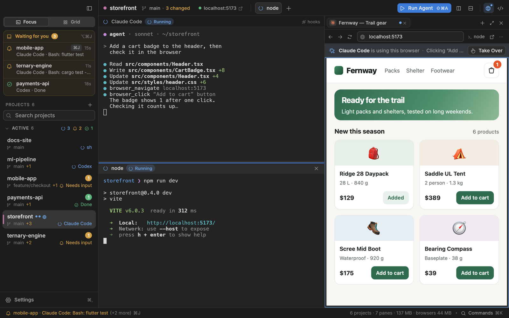
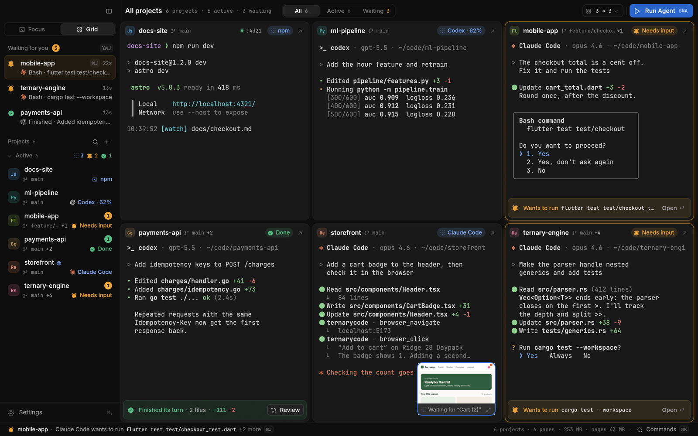

<p align="center">
  
</p>

<h1 align="center">TernaryCode</h1>

<p align="center">
  <b>One window for all your projects and the AI coding agents working in them.</b><br>
  A native, terminal-first workspace for macOS, Windows and Linux, written in Rust.
</p>

<p align="center">
  <a href="https://github.com/ilhamnadhif/ternarycode/releases/latest"></a>
  <a href="https://github.com/ilhamnadhif/ternarycode/actions/workflows/ci.yml"></a>
  
  <a href="LICENSE"></a>
</p>

<p align="center">
  <a href="https://ilhamnadhif.github.io/ternarycode/"><b>Website</b></a> ·
  <a href="#install">Install</a> ·
  <a href="#features">Features</a> ·
  <a href="#keyboard-shortcuts">Shortcuts</a> ·
  <a href="#troubleshooting">Troubleshooting</a> ·
  <a href="#build-from-source">Build</a> ·
  <a href="README.id.md">Bahasa Indonesia</a>
</p>



Running Claude Code, Codex, Antigravity CLI or OpenCode in several projects at once usually means
several windows and no idea which agent is waiting for you. TernaryCode puts every project in one
window, with its own terminals, tabs and splits, and answers one question at a glance: **which
agent needs me now?**

It is one small native app (no Electron): it opens in about 0.2 s, idles at 0 % CPU, and ten panes
take around 70 MB.

## Highlights

- **Know which agent needs you.** *Needs input*, *Running*, *Done* and *Failed* come from the
  agents' own hooks, never a guess. `⌘J` jumps to the most urgent one.
- **Every project in one window**, and a **Grid** that shows them all live.
- **A browser your agents can use.** An agent opens your dev server beside its terminal, clicks
  through it and reads the console; you watch, and take over at any time.
- **Code beside the agent**: files it changed, lines it touched, your language servers.
- **Review** what an agent changed, and give each agent **a git worktree** of its own.
- **Documents in place**: PDF, Word, PowerPoint, Excel, CSV and images.

## Install

Download from the [latest release](https://github.com/ilhamnadhif/ternarycode/releases/latest):

| System | File |
| --- | --- |
| macOS 12+ (Apple Silicon and Intel) | the installer below, or `TernaryCode-<version>.dmg` |
| Windows 10 (1809)+, x64 | `…-windows-x64-setup.exe`, or the portable `…-windows-x64.zip` |
| Debian, Ubuntu, Mint | `…-linux-amd64.deb` (`-arm64.deb` on ARM) |
| Fedora, RHEL, openSUSE | `…-linux-x86_64.rpm` (`-aarch64.rpm`) |
| Any Linux | `…-linux-x86_64.AppImage` or `.tar.gz` (`-aarch64` on ARM) |

**macOS**, in Terminal:

```sh
curl -fsSL https://raw.githubusercontent.com/ilhamnadhif/ternarycode/main/scripts/install.sh | bash
```

It checks the download's SHA-256 and signature and installs into `/Applications`.

> [!IMPORTANT]
> The builds are not notarized or code-signed yet. On macOS, a `.dmg` downloaded with a browser is
> blocked: use the installer above, or **System Settings → Privacy & Security → Open Anyway**. On
> Windows, SmartScreen asks once: **More info → Run anyway**.

On Linux, TernaryCode needs OpenGL (a software renderer is fine) and glibc 2.28+; the Browser panel
needs WebKitGTK 4.1 (`libwebkit2gtk-4.1-0`).

TernaryCode updates itself (the `.deb`, `.rpm` and portable `.zip` through a new package).

## Quick start

1. **Add a project**: click **+** in the sidebar, drop a folder on the window, or run
   `ternarycode .` in any terminal. On first start it offers the git repositories it finds in your
   usual folders.
2. **Run Agent** (`⇧⌘A`): pick Claude Code, Codex, Antigravity CLI or OpenCode. It starts in the
   terminal you are in and reports its status for that run.
3. Work on something else. When an agent waits, its project says **Needs input** and the status
   bar names it: `⌘J` takes you there, `⇧⌘J` back.

The agents are installed on their own (`claude`, `codex`, `agy`, `opencode`); when one is missing,
Run Agent shows how to install it.

## Features

### Projects, terminals and agents

- **A project is a folder**: its terminals, files and git changes. The sidebar shows its kind,
  branch, changes and what its agent is doing; `⌥⌘B` narrows it to a column of project tiles.
- **Tabs and splits per project**, restored at the next start. Restored shells start only when
  you look at them, so twenty projects open as fast as one.
- **Run Agent** starts a preset (or your own command) in the terminal you are in, a new tab or a
  split, optionally in **a new git worktree**, so agents never write over each other's files.
  Agents that can continue a conversation offer **Resume** after a restart.
- **A real terminal**: 24-bit colour, mouse, IME, links (`⌘`-click), search (`⌘F`, `⇧⌘F` in all
  panes), shell integration for zsh, bash, fish and PowerShell. Local servers a pane starts show
  as a chip; a click opens them in the Browser panel.

### Knowing which agent needs you



- Status comes from the agent's **hooks**, then terminal notifications, shell integration and the
  running program. Without a reliable signal it says *Active*, never a guess.
- **Waiting for you** at the top of the sidebar lists the agents that wait, failed or finished, in
  the order `⌘J` visits them. Notifications and the Dock badge appear only when you are not looking.
- **The Grid** (`⌘0`) shows every project live; a finished agent's tile says how many files it
  changed, with **Review** at hand.

Hooks are added **per launch** for Claude Code and Codex (nothing in your config changes), or
**installed once** (Settings → Agents) so agents you start by hand report too. Installing shows
the exact change and keeps a backup; **Uninstall** restores the file byte for byte. Antigravity
CLI has no hooks yet: its status shows *Active*.

### A browser for you and your agents

Each project has a **Browser panel** beside its terminals (`⇧⌘B`), on the system's own web view
(WebKit, WebView2, WebKitGTK).

- **Agents check their own work in it**: open a page, click, type, scroll, read the page and the
  console, answer dialogs, upload files. Their clicks and keys are real events. You see what the
  agent does; click or type in the page to **Take Over**, **Hand Back** to let it go on.
- **It works as a browser does**: sign-in pop-ups, downloads, find in page, zoom, the web
  inspector, one login profile for every project.
- Each agent gets a page of its own; busy pages never sleep; agents never type your passwords.

### Code, Review and documents


- **The Code drawer** (`⌘E`) opens beside the terminals: the files an agent changed carry its logo,
  and lines added, changed or removed since it started are marked by the line numbers. With your
  language servers (rust-analyzer, gopls, TypeScript, pyright, clangd…): definitions, references,
  rename, code actions, completion, hover and problems. Servers start only when needed.
- **Review** (`⇧⌘R`) shows what changed since the agent started or since the last commit, with the
  words that changed highlighted, unified or side by side. A worktree's review lists its commits
  and ends with **Merge** and **Remove**.
- **Documents** open in place: PDF, Word, PowerPoint, Excel and CSV (as a table), and images, read
  in Rust off the UI thread.


### Platforms

macOS, Windows and Linux get the same app. On Windows TernaryCode draws its own title bar with
menus, panes run PowerShell 7 (or Windows PowerShell), and hooks use a named pipe. On Linux the
Browser panel needs WebKitGTK; without it, pages open in your default browser. End-to-end tests of
the real app run on macOS.

## Keyboard shortcuts

On Windows and Linux, `⌘` is `Ctrl+Shift` (`⌥` stays `Alt`), so `Ctrl+C` still reaches the
terminal. The command palette (`⌘K`) lists everything.

| macOS | Windows, Linux | |
| --- | --- | --- |
| `⌘J` · `⇧⌘J` | `Ctrl+Shift+J` · `Ctrl+Alt+J` | next waiting agent · back |
| `⌘K` · `⌘P` | `Ctrl+Shift+K` · `Ctrl+Shift+P` | command palette · switch project |
| `⇧⌘A` | `Ctrl+Shift+A` | run an agent |
| `⌘0` | `Ctrl+Shift+0` | Grid |
| `⌘T` · `⌘W` | `Ctrl+Shift+T` · `Ctrl+Shift+W` | new tab · close pane |
| `⌘D` · `⇧⌘D` | `Ctrl+Shift+D` · `Ctrl+Shift+E` | split right · down |
| `⌘E` · `⌘O` · `⌘S` | `Ctrl+Shift+Y` · `Ctrl+Shift+O` · `Ctrl+Shift+S` | Code drawer · open file · save |
| `⇧⌘R` | `Ctrl+Shift+R` | review changes |
| `⇧⌘B` | `Ctrl+Shift+Alt+B` | Browser panel |
| `⌘F` · `⇧⌘F` | `Ctrl+Shift+F` · `Ctrl+Shift+G` | find · in all panes |
| `⌘B` · `⌥⌘B` | `Ctrl+Shift+B` · `Ctrl+Alt+B` | sidebar · narrow sidebar |
| `⌘1`–`⌘9` | `Ctrl+Shift+1`–`9` | project 1–9 |

## Troubleshooting

- **An agent shows only *Active*.** It was started by hand without hooks: use **Run Agent**, or
  install the hooks in **Settings → Agents**.
- **Windows: "running scripts is disabled".** Run `Set-ExecutionPolicy -Scope CurrentUser RemoteSigned`
  once, or install PowerShell 7 (`winget install Microsoft.PowerShell`).
- **Linux: the window stays blank.** Check that OpenGL works; `LIBGL_ALWAYS_SOFTWARE=1 ternarycode`
  uses Mesa's software renderer.
- Anything else: [open an issue](https://github.com/ilhamnadhif/ternarycode/issues) with your
  version, system and the steps.

## Privacy

No account, no telemetry. TernaryCode connects only to GitHub, to check for updates (you can turn
it off). Hooks and browser tools talk to the app over a local socket with a token per pane.
Settings live in `~/Library/Application Support/ternarycode` (macOS), `%APPDATA%\ternarycode`
(Windows) or `~/.local/share/ternarycode` (Linux).

## Build from source

```sh
cargo build --release       # ternarycode and ternarycode-hook, side by side
./target/release/ternarycode
```

Before a pull request, run what CI runs: `cargo clippy --workspace --all-targets -- -D warnings`
and `cargo test --workspace` (and `scripts/e2e.sh` on macOS, which drives the real app). The code
is formatted by hand: please don't run `cargo fmt` over whole files.

Built with [egui](https://github.com/emilk/egui), [alacritty_terminal](https://github.com/alacritty/alacritty)
and [wry](https://github.com/tauri-apps/wry). Fonts: Inter and JetBrains Mono (SIL OFL 1.1),
Phosphor icons (MIT).

TernaryCode is one of the Ternary apps, with [TernaryGrid](https://github.com/ilhamnadhif/ternarygrid)
(SQL), [TernaryWire](https://github.com/ilhamnadhif/ternarywire) (API) and
[TernaryShell](https://github.com/ilhamnadhif/ternaryshell) (SSH).

## License

MIT.
