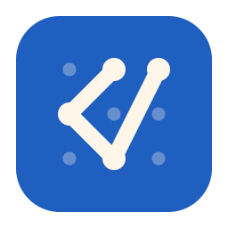
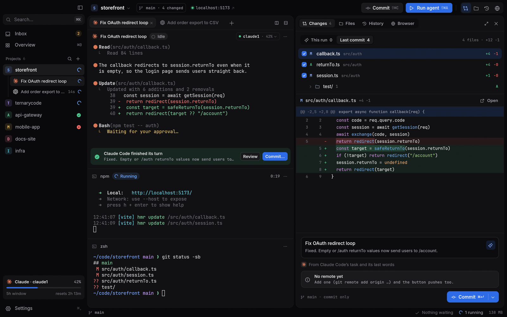
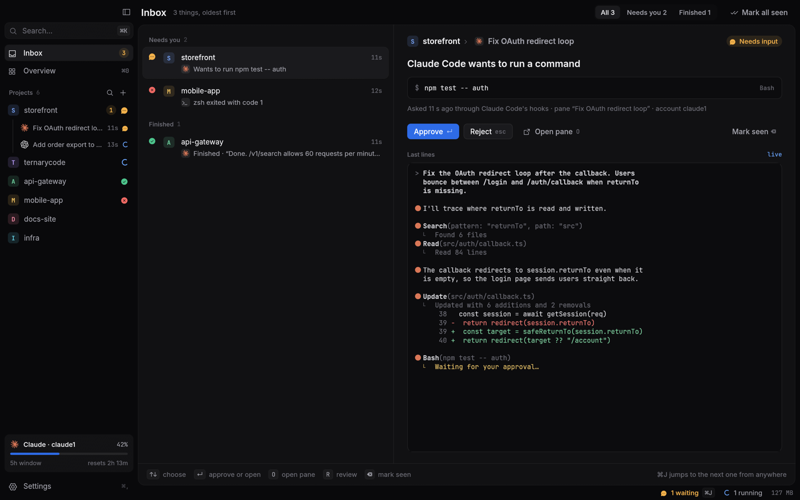
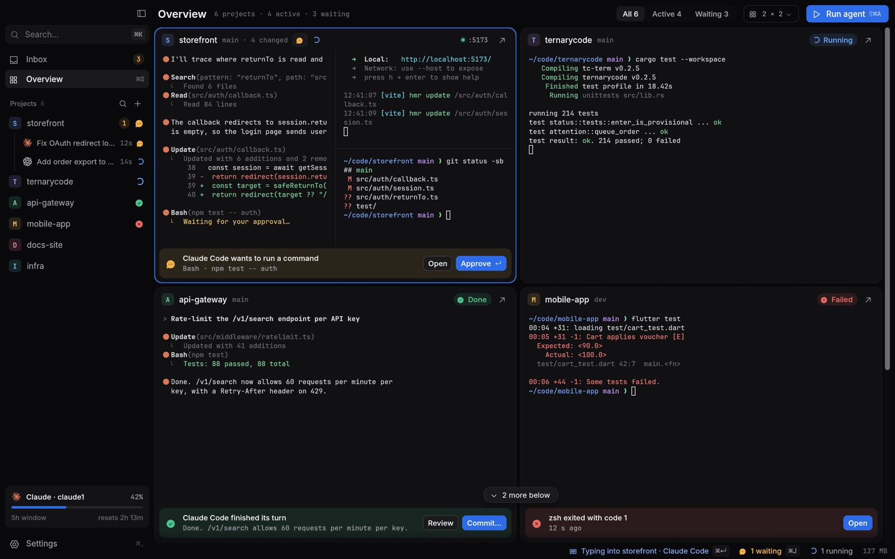
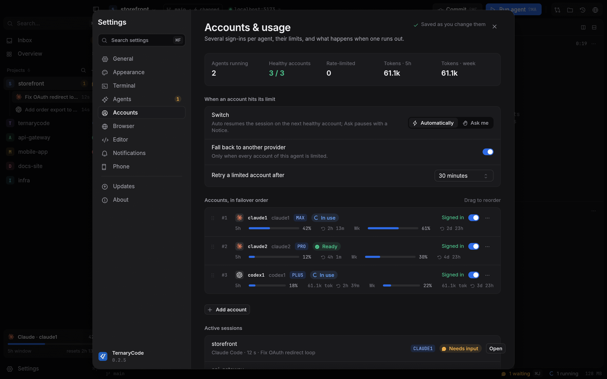
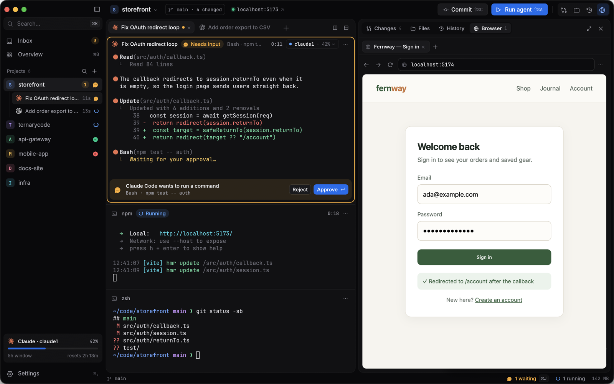

<p align="center">
  
</p>

<h1 align="center">TernaryCode</h1>

<p align="center">
  <b>One native workspace for all your projects and AI coding agents.</b><br>
  Terminals first, every agent's status at a glance, one Inbox for what waits for you, multi-account failover with real 5-hour &amp; weekly limits, a browser your agents can drive, and a phone companion — written in Rust for macOS, Windows, and Linux.
</p>

<p align="center">
  <a href="https://github.com/ilhamnadhif/ternarycode/releases/latest"></a>
  <a href="https://github.com/ilhamnadhif/ternarycode/actions/workflows/ci.yml"></a>
  
  <a href="LICENSE"></a>
</p>

<p align="center">
  <a href="https://ilhamnadhif.github.io/ternarycode/"><b>Website</b></a> ·
  <a href="#install">Install</a> ·
  <a href="#features">Features</a> ·
  <a href="#keyboard-shortcuts">Shortcuts</a> ·
  <a href="#troubleshooting">Troubleshooting</a> ·
  <a href="#build-from-source">Build</a> ·
  <a href="README.id.md">Bahasa Indonesia</a>
</p>


Running **Claude Code**, **Codex**, **Antigravity CLI (`agy`)**, or **OpenCode** across several projects usually means scattered terminal windows, logging out and in again when an account hits its limit, and guessing which agent is waiting for you. TernaryCode puts every project, session, account and page in one fast native app.

No Electron, no cloud middleman: it launches in ~0.2 s, idles at 0% CPU, and keeps every credential on your machine.

## Highlights

- **Terminals are the stage.** Tabs and split panes per project; every pane says what runs there, its status, how long, and which account. Changes, Files, History and the Browser open in one panel beside them (`⇧⌘L`, `⇧⌘E` to fill the window).
- **Know which agent needs you.** Hook-backed *Needs input*, *Running*, *Done* and *Failed*; a question shows as a notice with **Approve ↵** right in the pane. The **Inbox** lists everything that waits, `⌘J` jumps to the next one.
- **Every project at once.** The **Overview** (`⌘0`) shows each project's live terminal (and its page) in tiles; type into any of them.
- **Accounts without the logout dance.** Several Claude Code and Codex accounts with isolated logins, real server-reported 5-hour and weekly usage, and one-click (or automatic) failover that resumes the same conversation on the next account.
- **A browser your agents can drive** — WebKit, WebView2 or WebKitGTK — while you watch, plus PDF, Word, PowerPoint, Excel, CSV and images in place.
- **Review and ship.** Diffs per run, branch or commit, a commit message written from the agent's task, and Commit & Push / pull request in one button. Worktrees give each agent its own branch.
- **Your phone** follows the agents over your Wi-Fi: live output, Approve/Reject, follow-ups, account switches.

## Install

Download from the [latest release](https://github.com/ilhamnadhif/ternarycode/releases/latest):

| System | File |
| --- | --- |
| macOS 12+ (Apple Silicon and Intel) | the installer below, or `TernaryCode-<version>.dmg` |
| Windows 10 (1809)+, x64 | `…-windows-x64-setup.exe`, or the portable `…-windows-x64.zip` |
| Debian, Ubuntu, Mint | `…-linux-amd64.deb` (`-arm64.deb` on ARM) |
| Fedora, RHEL, openSUSE | `…-linux-x86_64.rpm` (`-aarch64.rpm`) |
| Any Linux | `…-linux-x86_64.AppImage` or `.tar.gz` (`-aarch64` on ARM) |

**macOS**, in Terminal:

```sh
curl -fsSL https://raw.githubusercontent.com/ilhamnadhif/ternarycode/main/scripts/install.sh | bash
```

It checks the download's SHA-256 and signature and installs into `/Applications`.

> [!IMPORTANT]
> The builds are not notarized or code-signed yet. On macOS, a `.dmg` downloaded with a browser is
> blocked: use the installer above, or **System Settings → Privacy & Security → Open Anyway**. On
> Windows, SmartScreen asks once: **More info → Run anyway**.

On Linux, TernaryCode needs OpenGL (a software renderer is fine) and glibc 2.28+; the Browser needs WebKitGTK 4.1 (`libwebkit2gtk-4.1-0`).

TernaryCode updates itself (the `.deb`, `.rpm`, and portable `.zip` through a new package).

## Quick start

1. **Add a project**: **+** in the sidebar, drop a folder on the window, or run `ternarycode .` in any terminal.
2. **Run an agent** (`⇧⌘A`): Claude Code, Codex, Antigravity CLI or OpenCode, in a new tab, this tab, or a new worktree — or resume one of its earlier sessions.
3. **Answer it where it asks**: Approve or Reject in the pane, or `⌘J` to the next agent that waits. Everything waiting is in the **Inbox**.
4. **Add your other accounts** (optional): **Settings → Accounts → Add account**, sign in once per account, drag to set the failover order.

## Features

### The workspace



- **Sidebar**: Search (`⌘K` searches everything), Inbox, Overview, then your projects in the order you choose (`⌥⌘↑` / `⌥⌘↓`, `⌘1`–`⌘9`). The selected project opens its sessions and worktrees; the account in use sits at the foot as one meter.
- **Panes** with a header that tells the truth: the agent, its status, what it is doing or asking, a timer, and the account (switch it from there). Notices in the pane for questions, usage limits, sessions to resume, and shells that ended.
- **The right panel**: **Changes** (this run, the branch, the last commit), **Files** (tree and editor with language servers), **History** (commits, pull requests, fetch), **Browser**. `⇧⌘E` fills the window; `⌥⌘Z` (Zen) shows only the terminals.
- **Command palette** (`⌘K`): projects, sessions (live and resumable), files, output of every pane, and every command.

### Inbox and Overview





### Accounts and usage



- Register several **Claude Code** and **Codex** accounts; each keeps its own login folder (`CLAUDE_CONFIG_DIR` / `CODEX_HOME`).
- Real usage: 5-hour and weekly percentages, plan and reset time, as the agents report them.
- When an account hits its limit, the pane says so and offers **Resume on** the next healthy account — or failover does it for you and resumes the same conversation.

### Browser and documents



- A native web view your agents drive through MCP tools (navigate, click, type, read, screenshot) while you watch; take over any time.
- PDF, Word, PowerPoint, Excel, CSV (as a table) and images open in the Files panel beside the agent that wrote them.

### Phone

Turn on **Settings → Phone**, scan the QR code, and follow every agent from your phone on the same Wi-Fi (or your own tunnel): live output, Approve / Reject, follow-ups and account switches. Each phone gets its own revocable token.

## Keyboard shortcuts

On Windows and Linux, `⌘` is `Ctrl+Shift` (`⌥` stays `Alt`), so `Ctrl+C` still reaches the terminal. The command palette (`⌘K`) lists everything.

| macOS | Windows, Linux | |
| --- | --- | --- |
| `⌘K` · `⌘P` | `Ctrl+Shift+K` · `Ctrl+Shift+P` | command palette · switch project |
| `⌘J` · `⇧⌘J` | `Ctrl+Shift+J` · `Ctrl+Alt+J` | next waiting agent · back |
| `⇧⌘A` | `Ctrl+Shift+A` | run an agent |
| `⌘0` | `Ctrl+Shift+0` | Overview |
| `⇧⌘R` · `⌘E` · `⇧⌘B` | `Ctrl+Shift+R` · `Ctrl+Shift+Y` · `Ctrl+Shift+Alt+B` | Changes · Files · Browser |
| `⇧⌘L` · `⇧⌘E` | `Ctrl+Shift+L` · `Ctrl+Alt+E` | show/hide the panel · fill the window |
| `⇧⌘C` | `Ctrl+Shift+Alt+C` | commit, push & pull request |
| `⌘T` · `⌘W` | `Ctrl+Shift+T` · `Ctrl+Shift+W` | new tab · close pane |
| `⌘D` · `⇧⌘D` | `Ctrl+Shift+D` · `Ctrl+Shift+E` | split right · down |
| `⌘F` · `⇧⌘F` | `Ctrl+Shift+F` · `Ctrl+Shift+G` | find · in every pane |
| `⌘B` · `⌥⌘B` · `⌥⌘Z` | `Ctrl+Shift+B` · `Ctrl+Alt+B` · `Ctrl+Alt+Z` | sidebar · narrow sidebar · Zen |
| `⌘1`–`⌘9` · `⌥⌘↑` `⌥⌘↓` | `Ctrl+Shift+1`–`9` · `Ctrl+Alt+↑` `↓` | project 1–9 · move project |

## Troubleshooting

- **An agent's pane says *Not connected*.** It was started by hand without hooks: click it to connect, use **Run agent**, or install hooks in **Settings → Agents**.
- **Windows: "running scripts is disabled".** Run `Set-ExecutionPolicy -Scope CurrentUser RemoteSigned` once, or install PowerShell 7 (`winget install Microsoft.PowerShell`).
- **Linux: the window stays blank.** Check OpenGL; `LIBGL_ALWAYS_SOFTWARE=1 ternarycode` uses Mesa's software renderer.
- Anything else: [open an issue](https://github.com/ilhamnadhif/ternarycode/issues) with your version, system, and steps.

## Privacy

No cloud account, no telemetry. TernaryCode only checks GitHub for app updates (optional); pull requests go through your own `gh` / `glab`; the phone companion stays on your network (or your own tunnel) with revocable per-device tokens and secrets redacted from what it streams. Settings and account folders live in `~/Library/Application Support/ternarycode` (macOS), `%APPDATA%\ternarycode` (Windows), or `~/.local/share/ternarycode` (Linux).

## Build from source

```sh
cargo build --release       # ternarycode and ternarycode-hook, side by side
./target/release/ternarycode
```

Before a pull request, run: `cargo clippy --locked --workspace --all-targets -- -D warnings` and `cargo test --locked --workspace` (plus `scripts/e2e.sh` on macOS). The code is formatted by hand: please don't run `cargo fmt` over whole files.

Built with [egui](https://github.com/emilk/egui), [alacritty_terminal](https://github.com/alacritty/alacritty), and [wry](https://github.com/tauri-apps/wry). Fonts: Inter and JetBrains Mono (SIL OFL 1.1), Phosphor icons (MIT).

TernaryCode is part of the Ternary family alongside [TernaryGrid](https://github.com/ilhamnadhif/ternarygrid) (SQL), [TernaryWire](https://github.com/ilhamnadhif/ternarywire) (API), and [TernaryShell](https://github.com/ilhamnadhif/ternaryshell) (SSH).

## License

MIT.
