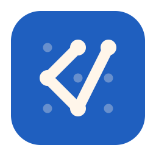
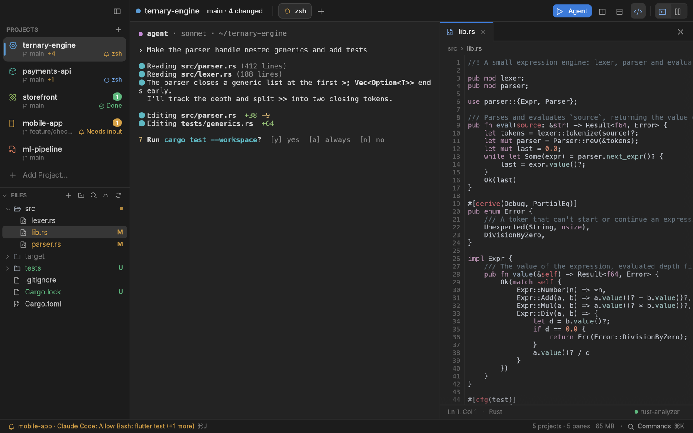
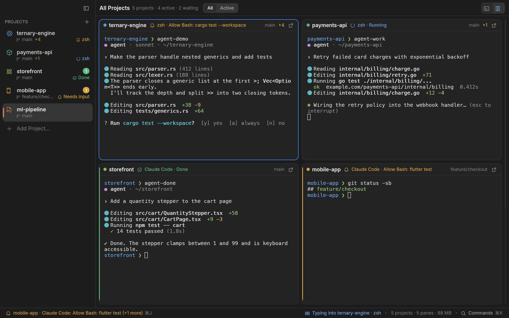
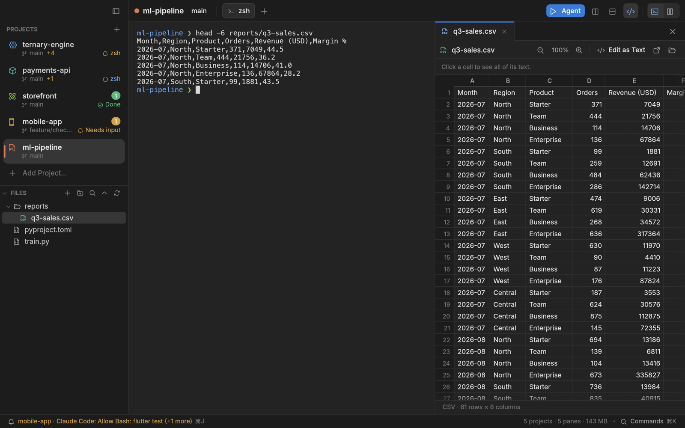

<p align="center">
  
</p>

<h1 align="center">TernaryCode</h1>

<p align="center">
  <b>One window for all your projects and the AI coding agents working in them.</b><br>
  A native, terminal-first workspace for macOS, Windows and Linux, written entirely in Rust.
</p>

<p align="center">
  <a href="https://github.com/ilhamnadhif/ternarycode/releases/latest"></a>
  <a href="https://github.com/ilhamnadhif/ternarycode/actions/workflows/ci.yml"></a>
  
  <a href="LICENSE"></a>
</p>

<p align="center">
  <a href="README.id.md">Bahasa Indonesia</a> ·
  <a href="#install">Install</a> ·
  <a href="#features">Features</a> ·
  <a href="#keyboard-shortcuts">Shortcuts</a> ·
  <a href="#build-from-source">Build</a>
</p>



Running Claude Code, Codex, Gemini CLI or OpenCode in five projects at once usually means five
editor windows, each with an agent hidden in a terminal panel, and no idea which one is waiting
for you. TernaryCode puts every project in **one window**: each with its own terminals, tabs and
split panes, a **Grid** that shows them all at once, and one question answered quickly and
honestly: **which agent needs me now?**

It is one small native binary (no Electron, no webview, no Node.js): the window is up in about
0.2 s, it idles at 0 % CPU, and ten open panes take around 70 MB.

## Highlights

- **Agent status you can trust.** Every pane knows whether its agent is working, waiting for you,
  done or failed, from the agent's own hooks, the terminal's notifications and the shell. Each
  status says where it came from; without a reliable signal it says only that the agent is
  *Active* instead of guessing.
- **Jump to what needs you.** `⌘J` goes to the most urgent waiting agent and `⇧⌘J` back. The
  status bar names it, the Dock shows a badge, and a notification arrives when the window is in
  the background. Keyboard focus never moves by itself.
- **The Grid** shows every project live, side by side, each terminal filling its tile: **All
  Projects** at the top of the sidebar (or `⌘0`) opens it, a project below opens it on its own.
  **Active** keeps only the projects where something runs or waits.
- **An editor beside the terminal**, with language servers you already have (rust-analyzer, gopls,
  typescript-language-server, Dart, pyright, clangd…): ⌘-click to a definition, references,
  rename across files, code actions, completion, hover and problems.
- **Documents open right there**: PDF, Word, PowerPoint, Excel, CSV and images, read-only and fast,
  and `⌘F` searches them.
- **`ternarycode my-app`** in any terminal opens that project (or folder) in the window.
- **Review** what an agent changed since it started, or since your last commit.
- **Updates itself** from GitHub releases, with one click.

## Install

Download from the [latest release](https://github.com/ilhamnadhif/ternarycode/releases/latest):

| System | Download |
| --- | --- |
| macOS 12 Monterey or later (Apple Silicon and Intel) | the one-line installer below, or `TernaryCode-<version>.dmg` |
| Windows 10 (1809) or later, x64 | `TernaryCode-<version>-windows-x64-setup.exe`, or the portable `-windows-x64.zip` |
| Debian, Ubuntu, Mint, Pop!_OS | `TernaryCode-<version>-linux-amd64.deb` (`-arm64.deb` on ARM) |
| Fedora, RHEL, Rocky, AlmaLinux, openSUSE | `TernaryCode-<version>-linux-x86_64.rpm` (`-aarch64.rpm`) |
| Any Linux (Arch, Manjaro…) | `TernaryCode-<version>-linux-x86_64.AppImage` or `.tar.gz` (`-aarch64` on ARM) |

### macOS

```sh
curl -fsSL https://raw.githubusercontent.com/ilhamnadhif/ternarycode/main/scripts/install.sh | bash
```

The script downloads the latest release, checks its SHA-256 and code signature, installs
`TernaryCode.app` into `/Applications` and opens it. Run it again to update, or pass a version:
`… | bash -s -- v0.1.0`.

Or download the `.dmg`, open it and drag **TernaryCode** onto **Applications**.

> **“TernaryCode” Not Opened / “Apple could not verify…”?** Releases are not notarized by Apple
> yet, so macOS blocks an app downloaded with a browser. Use the one-line installer above (nothing
> downloaded with `curl` is blocked), or click **Done**, open **System Settings → Privacy &
> Security** and click **Open Anyway** next to “TernaryCode was blocked…”, or run
> `xattr -dr com.apple.quarantine /Applications/TernaryCode.app`.

### Windows

Run **`TernaryCode-<version>-windows-x64-setup.exe`**. It installs for your user without
administrator rights (choose **Install for all users** in its first window to use Program Files),
adds TernaryCode to the Start menu, and can put `ternarycode` on the PATH so `ternarycode .` opens
the current folder as a project (on by default). Or unpack the portable **`.zip`** anywhere.

Panes run PowerShell 7 (`pwsh`) when it is installed, otherwise Windows PowerShell, with shell
integration loaded without touching your profile or execution policy. Agents run as they do in any
terminal (Claude Code, Codex, Gemini CLI and OpenCode all work natively on Windows), and their
hooks reach the app over a named pipe. On Windows 10 the console host may drop the shell's prompt
marks; status then comes from the agents' hooks and the running program.

> **“Windows protected your PC”?** The builds are not code-signed yet, so SmartScreen warns about
> a new download. Click **More info**, then **Run anyway**.

### Linux

TernaryCode runs on X11 and Wayland with OpenGL (a software renderer is fine) and needs glibc 2.28
or later (RHEL 8, Debian 10, Ubuntu 18.10 and newer).

```sh
sudo apt install ./TernaryCode-<version>-linux-amd64.deb               # Debian, Ubuntu, Mint, Pop!_OS
sudo dnf install ./TernaryCode-<version>-linux-x86_64.rpm              # Fedora, RHEL, Rocky, AlmaLinux
chmod +x TernaryCode-<version>-linux-x86_64.AppImage && ./TernaryCode-<version>-linux-x86_64.AppImage
tar -xzf TernaryCode-<version>-linux-x86_64.tar.gz -C ~/.local --strip-components=1   # then: ternarycode
```

### Open projects from a terminal

```sh
ternarycode .              # this folder, as a project
ternarycode ~/code/shop    # any folder
ternarycode shop           # the project named "shop" (or the folder "shop" beside your projects)
```

The project opens in the running window (TernaryCode starts if it isn't running, apart from the
terminal, so closing the terminal doesn't close it). The command works in every TernaryCode pane;
for other terminals, TernaryCode puts it on your `PATH` at launch on macOS (Homebrew's `bin`,
`/usr/local/bin` or `~/.local/bin`, whichever you can write; otherwise **Settings → General →
Command line**), the Linux packages install it, and the Windows setup adds it to `PATH`.

### Updates

TernaryCode checks GitHub for a new release when it starts and every few hours while it runs.
When one is out, the update window shows what's new; **Install Update** downloads it, verifies its
size and the SHA-256 GitHub publishes (and on macOS the bundle id, version and code signature),
then restarts into the new version with your projects and tabs restored. Later checks don't
interrupt you: an **Update** item appears in the status bar instead.

The `.dmg`/installer copy on macOS, the Windows setup, the AppImage and the `.tar.gz` update
themselves; the `.deb`, `.rpm` and the portable `.zip` are updated by installing the new package.
Turn automatic checks off in **Settings → General**, or use **Check for Updates…** any time. The
update check is the only network connection TernaryCode makes.

## Features

### Projects, terminals and agents

- **A project is a folder.** Its terminals start there, its files and git changes show beside
  them, and the sidebar shows its kind (Rust, Go, TypeScript, React, Flutter, Python…), branch,
  number of changes and what its agent is doing. Projects are listed by name, in the sidebar and
  in the Grid alike.
- **Tabs and split panes per project**, drag to rearrange, and restored when you open the app
  again. Restored shells start only when you look at them, so a workspace of twenty projects opens
  as fast as one.
- **Run an agent** in a new pane from presets (Claude Code, Codex, Gemini CLI, OpenCode, or your own
  command). Panes of agents that can continue a conversation offer **Resume** after a
  restart.
- **A real terminal**: 24-bit colour, mouse reporting, synchronized output, IME, pixel-exact
  box drawing, scrollback search in one pane (`⌘F`) or all of them (`⇧⌘F`), and `⌘`-click on a
  `path:line` to open it in the editor.
- **Shell integration** (zsh, bash, fish and PowerShell) marks prompts and commands, so a command that fails or
  finishes after a long time is noticed, and resizing never leaves prompt fragments behind.

### Knowing which agent needs you



- Each pane's status comes from, in order of trust: the agent's **hooks** (installed per agent in
  Settings → Integrations, or added per launch without touching your config), terminal
  notifications (OSC 9, 99 and 777), shell integration (OSC 133) and the foreground process.
- **Needs input**, **Running**, **Done**, **Failed** and **Idle** show in the sidebar, on tabs, in
  Grid tiles and in the status bar; the attention list (`⌥⌘J`) shows everything waiting, oldest
  first.
- Desktop notifications and the Dock badge only when you are not already looking.

| Agent | Per launch (no file changed) | Installed once |
| --- | --- | --- |
| Claude Code | `claude --settings "$TC_CLAUDE_SETTINGS"` adds hooks for that run | hooks in `~/.claude/settings.json` |
| Codex | `codex -c "$TC_CODEX_HOOKS" -c "$TC_CODEX_NOTIFY"` | a managed block in `~/.codex/config.toml` |
| Gemini CLI | — | hooks in `~/.gemini/settings.json` |
| OpenCode | — | the plugin `~/.config/opencode/plugins/ternarycode.js` |

Installing shows the exact change first and keeps a backup; **Uninstall** restores the file byte
for byte when you have not edited it since.

### Editor and language features

- Tabs, line numbers, syntax colours, find, and safe saves: it never overwrites a file
  an agent changed under your unsaved edits (you choose).
- With a language server installed: go to definition (`F12` or `⌘`-click), type definition,
  implementations, references (`⇧F12`), rename across files (`F2`, with one-step undo), code
  actions and quick fixes (`⌘.`), completion, hover, signature help, document and workspace
  symbols, problems (`⇧⌘M`) and format on save.
- Servers start when you open a file they serve and stop ten minutes after the last one closes. A
  missing server is named in the status line together with its install command.

### Documents



Click a file in the tree and it opens in place: **PDF** pages rendered at your zoom, **Word**
(`.docx`) and **PowerPoint** (`.pptx`) as readable text with headings, lists, tables and pictures,
**Excel** (`.xlsx`, `.xls`, `.ods`) and **CSV** as a grid with sheet tabs and a header that stays in
view, and **images**. Everything is read in pure Rust, off the UI thread; only what is on screen is
kept in memory.

`⌘F` (`Ctrl+Shift+F`) after clicking in a document searches it: words on PDF pages are highlighted
where they are printed, Word and PowerPoint text is highlighted in place, and in a spreadsheet the
selection moves from cell to matching cell, across sheets. `Enter` and `⇧Enter` go to the next and
previous match.

### Review

`⇧⌘R` shows what changed: since the agent in this pane started (a snapshot taken outside your git
index, so your staging area is never touched), or since the last commit. Open any file from the
diff in the editor.

## Keyboard shortcuts

On Windows and Linux, `⌘` shortcuts are `Ctrl+Shift+…` (`⌥` stays `Alt`), so `Ctrl+C`, `Ctrl+D`
and friends still reach the terminal. The command palette (`⌘K` / `Ctrl+Shift+K`) lists
everything, with its shortcut.

| macOS | Windows, Linux | |
| --- | --- | --- |
| `⌘J` · `⇧⌘J` | `Ctrl+Shift+J` · `Ctrl+Alt+J` | next waiting agent · back |
| `⌥⌘J` | `Ctrl+Shift+Alt+J` | attention list |
| `⌘K` | `Ctrl+Shift+K` | command palette |
| `⌘P` | `Ctrl+Shift+P` | switch project |
| `⇧⌘A` | `Ctrl+Shift+A` | run an agent |
| `⌘0` | `Ctrl+Shift+0` | Grid of all projects |
| `⌘T` · `⌘W` | `Ctrl+Shift+T` · `Ctrl+Shift+W` | new tab · close pane |
| `⇧⌘]` · `⇧⌘[` | `Ctrl+Shift+PageDown` · `Ctrl+Shift+PageUp` | next tab · previous tab |
| `⌘D` · `⇧⌘D` | `Ctrl+Shift+D` · `Ctrl+Shift+E` | split right · split down |
| `⌘]` · `⌘[` | `Ctrl+Shift+]` · `Ctrl+Shift+[` | next pane · previous pane |
| `⌘O` · `⌘E` · `⌘S` | `Ctrl+Shift+O` · `Ctrl+Shift+Y` · `Ctrl+Shift+S` | open file · show editor · save |
| `⇧⌘R` | `Ctrl+Shift+R` | review changes |
| `⌘F` · `⇧⌘F` | `Ctrl+Shift+F` · `Ctrl+Shift+G` | find in the pane, file or document · in all panes |
| `⌘B` · `⌘1`–`⌘9` | `Ctrl+Shift+B` · `Ctrl+Shift+1`–`9` | sidebar · project 1–9 |
| `⌘=` · `⌘-` | `Ctrl+Shift+=` · `Ctrl+Shift+-` · `Ctrl+Shift+Backspace` | bigger · smaller · actual size text |
| `⌥⌘K` | `Ctrl+Shift+Alt+K` | clear the scrollback |
| `F12` · `⇧F12` · `F2` · `⌘.` | `F12` · `Shift+F12` · `F2` · `Ctrl+.` | definition · references · rename · code actions |

In the editor, `Ctrl+Shift+-` is Forward (`⌃⇧-` on macOS), as in VS Code; elsewhere it makes the
text smaller.

## Privacy

No account, no telemetry. The only connection TernaryCode makes is the update check to GitHub,
which you can turn off. Hooks talk to the app over a private local socket (a named pipe on
Windows), and each pane has its own secret token.

Settings and the workspace live in `~/Library/Application Support/ternarycode` (macOS),
`%APPDATA%\ternarycode` (Windows) or `~/.local/share/ternarycode` (Linux).

## Build from source

Requires a recent stable Rust toolchain (built with 1.99).

```sh
cargo build --release      # ternarycode and ternarycode-hook, side by side in target/release
./target/release/ternarycode
```

`ternarycode-hook` must stay next to the app binary: agents' hooks run it, and it does nothing
outside a TernaryCode pane.

| | |
| --- | --- |
| `scripts/package.sh` | macOS: `TernaryCode.app`, `.dmg` and `.zip` (ad-hoc signed unless you set an identity) |
| `scripts/package-linux.sh` | Linux: `.tar.gz`, `.deb`, `.rpm`, `.AppImage` |
| `scripts/package-windows.ps1` | Windows: Inno Setup installer and portable `.zip` |
| `scripts/e2e.sh` | end-to-end checks of the real app on macOS (injected keyboard and mouse events) |
| `scripts/release.sh <x.y.z>` | tests, builds macOS, tags, and lets CI build Windows and Linux and publish |

### Layout

| Crate | |
| --- | --- |
| `crates/tc-term` | terminal core (alacritty_terminal), PTY (Unix and ConPTY), OSC signals, search, the egui terminal widget |
| `crates/tc-core` | model, agent presets and recognition, status state machine, attention queue, atomic files |
| `crates/tc-agent` | process info, hook protocol and server, `ternarycode-hook`, agent integrations, shell integration |
| `crates/tc-git` | snapshots and diffs through the git CLI, never touching the index |
| `crates/tc-lsp` | language server client: transport, server registry, positions, edits |
| `crates/tc-doc` | PDF, Word, PowerPoint, spreadsheet, CSV and image readers |
| `src/` | the app (egui) |

## The Ternary family

TernaryCode is one of four small, native Rust apps that share a look and a 3 × 3 lattice icon:
[TernaryGrid](https://github.com/ilhamnadhif/ternarygrid) (SQL client),
[TernaryWire](https://github.com/ilhamnadhif/ternarywire) (API client),
[TernaryShell](https://github.com/ilhamnadhif/ternaryshell) (SSH and SFTP client) and TernaryCode.

## License

MIT. Fonts: Inter (SIL OFL 1.1) and Phosphor icons (MIT).
