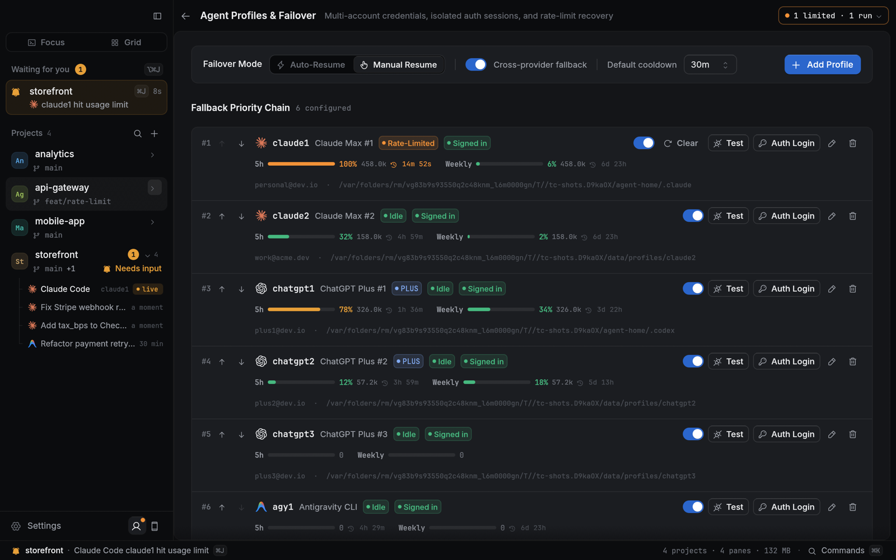
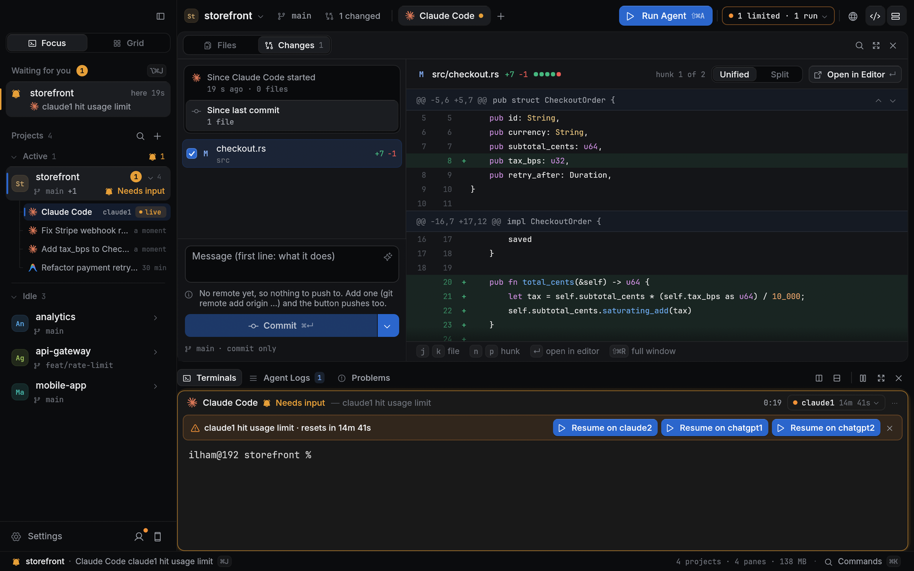

<p align="center">
  
</p>

<h1 align="center">TernaryCode</h1>

<p align="center">
  <b>One native Agent Development Environment (ADE) for all your projects and AI coding agents.</b><br>
  Wide code editor, project-nested sessions, multi-account failover with 5-hour &amp; weekly limits, live usage monitor, and mobile companion — written in Rust for macOS, Windows, and Linux.
</p>

<p align="center">
  <a href="https://github.com/ilhamnadhif/ternarycode/releases/latest"></a>
  <a href="https://github.com/ilhamnadhif/ternarycode/actions/workflows/ci.yml"></a>
  
  <a href="LICENSE"></a>
</p>

<p align="center">
  <a href="https://ilhamnadhif.github.io/ternarycode/"><b>Website</b></a> ·
  <a href="#install">Install</a> ·
  <a href="#features">Features</a> ·
  <a href="#keyboard-shortcuts">Shortcuts</a> ·
  <a href="#troubleshooting">Troubleshooting</a> ·
  <a href="#build-from-source">Build</a> ·
  <a href="README.id.md">Bahasa Indonesia</a>
</p>


Running **Claude Code**, **ChatGPT / Codex**, **Antigravity CLI (`agy`)**, or **OpenCode** across multiple projects usually means scattered terminal windows, manual logout/re-login dances when an account hits its usage limit, and guessing which agent is waiting for you. TernaryCode brings every project, session, account, and editor into one fast native Rust workspace.

No Electron, no cloud middleman: it launches in ~0.2 s, idles at 0% CPU, and keeps all credentials strictly local on your machine.

## Highlights

- **Wide Code Editor & Collapsible Terminal Panel**: the Code Editor & Diff Viewer commands the primary viewport (≥60% by default), while Terminals, Agent Logs, and LSP Problems live in a dockable bottom or right panel (`⇧⌘L`).
- **Project-Nested Agent Sessions**: expand any project in the sidebar to see live and past sessions for **Claude Code, Codex, and Antigravity CLI (`agy`)** with brand logos, live status pills, compact 3-row preview (`N more…` / `Show less`), and 1-click resume.
- **Multi-Account Profiles & Real 5-Hour / Weekly Usage Limits**: pre-register multiple **Claude Code** & **ChatGPT / Codex** accounts (`claude1`, `claude2`, `chatgpt1`, `chatgpt2`) with isolated file-backed auth folders, mouse drag-and-drop priority ordering, and real server-reported quotas & reset countdowns. Switch accounts in **one click without logging out**, or let Auto/Manual Failover resume your session automatically when an account hits its limit.
- **Unified All-Agent Usage & Status Monitor**: live top-bar telemetry pill, quick-switch popover, and full monitor tracking **5-hour** & **weekly** quotas, reset countdowns, active sessions, and failover events.
- **Phone Pairing & Mobile Companion**: pair your smartphone via QR code over local Wi-Fi or a secure tunnel to stream live agent output, approve pending tools, send follow-ups, and trigger profile failovers remotely.
- **Know Which Agent Needs You**: hook-backed *Needs input*, *Running*, *Done*, and *Failed* states, `⌘J` jump queue, and a live **Grid** (`⌘0`) of every project.
- **Commit History, GitHub & GitLab Integration, Review, Browser & Documents**: inspect git commit logs & per-commit diffs (`Files | Changes | History`), fetch remotes, view live open **GitHub PRs** & **GitLab MRs** (`gh` / `glab`), ship with 1-button Commit/Push/PR/MR, drive the built-in browser, and view PDF/Office/CSV/images in place.

## Install

Download from the [latest release](https://github.com/ilhamnadhif/ternarycode/releases/latest):

| System | File |
| --- | --- |
| macOS 12+ (Apple Silicon and Intel) | the installer below, or `TernaryCode-<version>.dmg` |
| Windows 10 (1809)+, x64 | `…-windows-x64-setup.exe`, or the portable `…-windows-x64.zip` |
| Debian, Ubuntu, Mint | `…-linux-amd64.deb` (`-arm64.deb` on ARM) |
| Fedora, RHEL, openSUSE | `…-linux-x86_64.rpm` (`-aarch64.rpm`) |
| Any Linux | `…-linux-x86_64.AppImage` or `.tar.gz` (`-aarch64` on ARM) |

**macOS**, in Terminal:

```sh
curl -fsSL https://raw.githubusercontent.com/ilhamnadhif/ternarycode/main/scripts/install.sh | bash
```

It checks the download's SHA-256 and signature and installs into `/Applications`.

> [!IMPORTANT]
> The builds are not notarized or code-signed yet. On macOS, a `.dmg` downloaded with a browser is
> blocked: use the installer above, or **System Settings → Privacy & Security → Open Anyway**. On
> Windows, SmartScreen asks once: **More info → Run anyway**.

On Linux, TernaryCode needs OpenGL (a software renderer is fine) and glibc 2.28+; the Browser panel needs WebKitGTK 4.1 (`libwebkit2gtk-4.1-0`).

TernaryCode updates itself (the `.deb`, `.rpm`, and portable `.zip` through a new package).

## Quick start

1. **Add a project**: click **+** in the sidebar, drop a folder on the window, or run `ternarycode .` in any terminal.
2. **Pre-register your accounts** (optional): open **Profiles** (bottom-left 👤), click **+ Add Profile**, choose **Claude Code** or **ChatGPT / Codex**, drag cards to order fallback priority, and click **Auth Login** once per account. Each account stays signed in inside its own private `0o700` folder.
3. **Run Agent** (`⇧⌘A`): launch Claude Code, Codex, Antigravity CLI (`agy`), or OpenCode. Expand the project in the sidebar anytime to resume past sessions in one click.
4. **Switch accounts or jump to waiting agents**: click `⇄ <next_account>` right in the pane header to switch accounts mid-session without logout, or press `⌘J` to jump to any waiting agent.

## Features

### Wide Code Editor & Project-Nested Sessions

- **Code-first workspace**: the Code Editor (`⌘E`) opens wide by default with smooth resizable splits, language servers (rust-analyzer, gopls, TypeScript, pyright, clangd…), and git gutter change markers.
- **Collapsible Terminal Panel** (`⇧⌘L`): dock Terminals, Agent Logs, and LSP Problems at the bottom or right, maximize to full height, or hide when reading code.
- **Project-nested session tree**: expand any project row in the left sidebar (`›`) to view live sessions (`● live`) and past history for **Claude Code**, **Codex**, and **Antigravity CLI** (`agy --conversation <id>`) — click any session to focus or resume directly.

### Multi-Account Profiles, 5-Hour & Weekly Limits, & 1-Click Switch



- **Zero logout/re-login dance**: register multiple **Claude Code** & **ChatGPT / Codex** accounts (`claude1`, `claude2`, `chatgpt1`, `chatgpt2`) upfront and drag-and-drop rows to arrange your fallback priority chain. Each isolated profile gets its own `CLAUDE_CONFIG_DIR` or file-backed `CODEX_HOME` (`auth.json`), plus automatic env cleanup across switches.
- **Accurate Server Usage Limit Meters**: tracks both **5-Hour rolling limits** and **Weekly (7-day) / 30-day limits** — reading real server-reported percentages, plan tiers, and exact reset timestamps directly from Claude Code (`cachedUsageUtilization`) and Codex (`rate_limits.primary` / `secondary`, `plan_type`).
- **1-Click Live Account Switch & Rate-Limit Failover**: click the `⇄` quick-switch button in any running agent pane header — or let **Auto-Resume** / **Manual Resume** kick in when a limit hits. Same-provider switches atomically copy the session file across isolated roots and natively `--resume` your exact conversation; cross-provider switches write a secret-redacted handoff note so work continues seamlessly.


### Unified All-Agent Usage & Status Monitor


- Click the top-bar telemetry pill to inspect every account's live state (`Running`, `Idle`, `Rate-Limited`, `Cooldown`, `Error`), **5h** & **Weekly** usage bars, reset countdowns, and trigger a 1-click **Switch** without leaving your code.
- Open **Full View** for aggregate **5-Hour Tokens**, **Weekly Tokens**, healthy account counts, active session jump links, and the live failover & agent event log.

### Phone Pairing & Mobile Companion


- Enable the built-in **Mobile Companion Server** (local Wi-Fi or optional Cloudflare / Tailscale / ngrok tunnel) and scan the QR code with your phone camera.
- Every paired device gets its own revocable bearer token (with brute-force rate limiting and secret-redacted output streaming). Monitor live terminal output over SSE, approve or reject pending tool requests, send follow-up prompts, and switch accounts remotely from your smartphone.

### Review, Worktrees, Grid, Browser & Documents



- **Commit History, Review, & GitHub / GitLab Integration** (`⇧⌘R`, `⇧⌘C`): switch cleanly between **Files | Changes | History** to inspect unified/split diffs, browse paginated commit logs & per-commit diffs, fetch remotes, view live open **GitHub PRs** (`gh`) & **GitLab MRs** (`glab`), and commit, push, or create a PR/MR in one button.
- **The Grid** (`⌘0`): monitor every project side by side in live terminals, with changed-file badges and 1-click Review.
- **Agent Browser** (`⇧⌘B`): native system web view (WebKit, WebView2, WebKitGTK) that agents can navigate, click, and inspect while you watch or Take Over anytime.
- **In-Place Documents**: open PDF, Word, PowerPoint, Excel, CSV (as an interactive table), and images directly beside your agent.


## Keyboard shortcuts

On Windows and Linux, `⌘` is `Ctrl+Shift` (`⌥` stays `Alt`), so `Ctrl+C` still reaches the terminal. The command palette (`⌘K`) lists everything.

| macOS | Windows, Linux | |
| --- | --- | --- |
| `⌘J` · `⇧⌘J` | `Ctrl+Shift+J` · `Ctrl+Alt+J` | next waiting agent · back |
| `⌘K` · `⌘P` | `Ctrl+Shift+K` · `Ctrl+Shift+P` | command palette · switch project |
| `⇧⌘A` | `Ctrl+Shift+A` | run an agent |
| `⌘0` | `Ctrl+Shift+0` | Grid |
| `⌘E` · `⇧⌘L` | `Ctrl+Shift+Y` · `Ctrl+Shift+L` | Code Editor · Terminal Panel |
| `⌘O` · `⌘S` | `Ctrl+Shift+O` · `Ctrl+Shift+S` | open file · save |
| `⌘T` · `⌘W` | `Ctrl+Shift+T` · `Ctrl+Shift+W` | new tab · close pane |
| `⌘D` · `⇧⌘D` | `Ctrl+Shift+D` · `Ctrl+Shift+E` | split right · down |
| `⇧⌘R` · `⇧⌘C` | `Ctrl+Shift+R` · `Ctrl+Shift+Alt+C` | review changes · commit, push & PR |
| `⇧⌘B` | `Ctrl+Shift+Alt+B` | Browser panel |
| `⌘F` · `⇧⌘F` | `Ctrl+Shift+F` · `Ctrl+Shift+G` | find · in all panes |
| `⌘B` · `⌥⌘B` | `Ctrl+Shift+B` · `Ctrl+Alt+B` | sidebar · narrow sidebar |
| `⌘1`–`⌘9` | `Ctrl+Shift+1`–`9` | project 1–9 |

## Troubleshooting

- **An agent shows only *Active*.** It was started by hand without hooks: use **Run Agent**, or install hooks in **Settings → Agents**.
- **Windows: "running scripts is disabled".** Run `Set-ExecutionPolicy -Scope CurrentUser RemoteSigned` once, or install PowerShell 7 (`winget install Microsoft.PowerShell`).
- **Linux: the window stays blank.** Check OpenGL; `LIBGL_ALWAYS_SOFTWARE=1 ternarycode` uses Mesa's software renderer.
- Anything else: [open an issue](https://github.com/ilhamnadhif/ternarycode/issues) with your version, system, and steps.

## Privacy

No cloud account, no telemetry. TernaryCode only checks GitHub for app updates (optional); pull requests go through your own GitHub CLI; Mobile Companion stays on your LAN (or your own tunnel) with revocable per-device tokens and automatic secret redaction. Settings and isolated profiles live in `~/Library/Application Support/ternarycode` (macOS), `%APPDATA%\ternarycode` (Windows), or `~/.local/share/ternarycode` (Linux).

## Build from source

```sh
cargo build --release       # ternarycode and ternarycode-hook, side by side
./target/release/ternarycode
```

Before a pull request, run: `cargo clippy --locked --workspace --all-targets -- -D warnings` and `cargo test --locked --workspace` (plus `scripts/e2e.sh` on macOS). The code is formatted by hand: please don't run `cargo fmt` over whole files.

Built with [egui](https://github.com/emilk/egui), [alacritty_terminal](https://github.com/alacritty/alacritty), and [wry](https://github.com/tauri-apps/wry). Fonts: Inter and JetBrains Mono (SIL OFL 1.1), Phosphor icons (MIT).

TernaryCode is part of the Ternary family alongside [TernaryGrid](https://github.com/ilhamnadhif/ternarygrid) (SQL), [TernaryWire](https://github.com/ilhamnadhif/ternarywire) (API), and [TernaryShell](https://github.com/ilhamnadhif/ternaryshell) (SSH).

## License

MIT.
